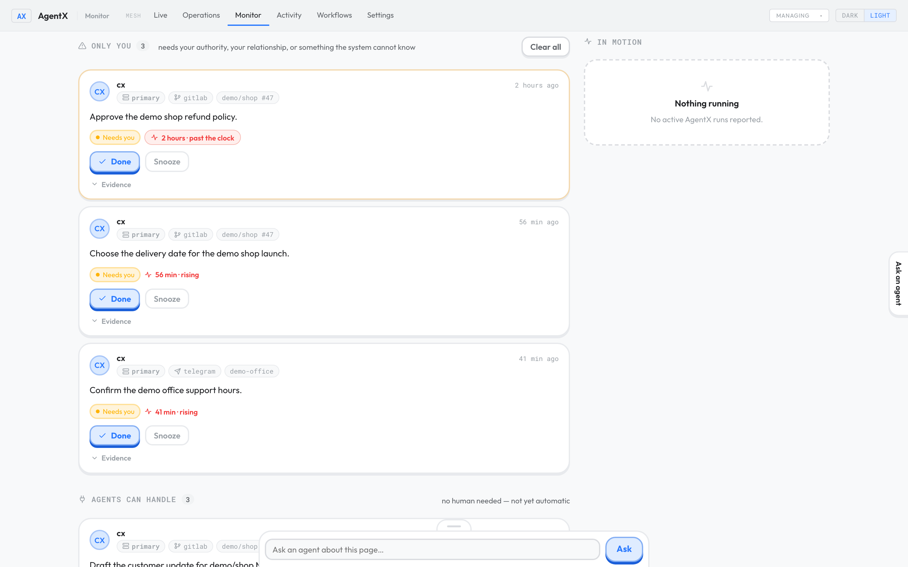

<div align="center">

**English** · [العربية](docs/ar/README.md)


# AgentX

**Put the coding agent you already use on call: it answers in chat and on issues, runs on a schedule, and asks you before anything that matters, on a machine you own.**

[](https://www.npmjs.com/package/agentix-cli)
[](https://github.com/anis-marrouchi/agentx/actions/workflows/ci.yml)
[](LICENSE)
[](package.json)
[](https://github.com/anis-marrouchi/agentx/actions/workflows/install-matrix.yml)

[Why](#why-this-exists) · [See the demo](#see-it-without-an-account) · [What we measured](#what-we-measured) · [The jobs](#the-jobs-agentx-does) · [Install](#install) · [How it works](#how-it-works)

</div>

Claude Code, Codex and OpenCode do real work, but only while you sit at the terminal. AgentX keeps them working when you are away:

1. **Give each agent a job.** Answer clients, send the daily report, or work on an issue.
2. **It works in your team's tools.** WhatsApp, Telegram, GitLab, GitHub and schedules, on a machine you own.
3. **You check the result and decide.** The browser dashboard shows what was done and what still needs you.

Try it now. No account, no API key, no paid model calls:

```sh
npx agentix-cli demo
```

## Why this exists

A coding agent in a terminal has four limits. AgentX removes each one and adds nothing else you have to learn first.

| The limit | What AgentX adds |
|---|---|
| It works only when you type to it. | **Channels.** A message on WhatsApp or Telegram, or an issue on GitLab or GitHub, starts the work. The answer goes back to the same place. |
| It does nothing by itself. | **Schedules.** A task runs at a set time: a morning brief, a daily report, a check that stays quiet unless it finds a problem. |
| It acts, or it stops and waits at a prompt nobody sees. | **Approvals.** Work that reaches a person or changes something waits in one list until you say yes. [What always waits for you](docs/jobs/keep-it-safe.md#what-always-waits-for-you). |
| You see the bill at the end of the month. | **Budgets.** A monthly dollar cap per agent, per project and for all agents. You get a notice at 80% and new work pauses at 100%. [Costs and caps](docs/help/costs.md). |

Everything an agent did is recorded and shown in the dashboard. It runs on your machine, with the model account you already have. Nothing is sent to the makers of AgentX. [Your data](docs/your-data.md).

## See it without an account

With Node.js 22.19 or newer, up to 26 (tested on 22, 24, 25 and 26), run:

```sh
npx agentix-cli demo
```

The demo starts three local AgentX daemons (the background service that runs the agents) and sends a task between them. Routing, network calls and the event record are real. Model responses are scripted, so the demo makes no billable model calls. The terminal prints the dashboard addresses. The first run downloads the package, which takes a minute or two. [What to expect](docs/see-it-first.md).



*The Monitor dashboard in the isolated demo. All displayed tasks are fictional.*

Short videos show one task each: [the **Learn AgentX** playlist on YouTube](https://www.youtube.com/playlist?list=PLWyRWfXkYvlw).

## What we measured

We publish the numbers, including the ones that do not flatter us.

| Question | Result | Source |
|---|---|---|
| How long from the install command to the first reply? | About 23 seconds on Linux and 24 seconds on macOS (median of 3 runs each, model key ready). An automated check times it on every change and fails above 5 minutes. | [First-reply check](https://github.com/anis-marrouchi/agentx/actions/workflows/first-reply.yml) |
| What does AgentX cost on top of the same agent alone? | On Sonnet 5.5, three coding tasks, ten runs each way: **2% more** with the lean profile and **22% more** with the full profile. On Haiku 4.5: no clear difference. Every run was correct on both sides. | [The comparison](bench/results/claude-code-comparison-455.md) |
| How much context does AgentX add before the model starts? | Count it yourself from a source checkout, with no model call: `pnpm bench:context`. | [Benchmarks](bench/README.md) |

AgentX is used every day. The [changelog](CHANGELOG.md) records each release.

## The jobs AgentX does

Each job comes as a **ready-made team**: agents with their instructions and their schedules, added in one command. [Start from a ready-made team](docs/jobs/ready-made-teams.md).

### Dev

An issue you assign on GitLab comes back as a small merge request with a test, and a second agent reviews it. On GitHub, the review gate checks each agent pull request against its issue before merge. **You approve:** the merge. Neither agent merges.

[Watch GitLab work](docs/jobs/watch-gitlab.md) · [Review gate](docs/jobs/review-gate.md) · [One folder per task](docs/jobs/task-worktrees.md)

### Clients and support

A client who writes on WhatsApp after hours gets an answer from your business notes within a minute. Prices, refunds, complaints and dates come to you. **You approve:** nothing by default, so use a separate number. To approve every reply, [watch a WhatsApp chat](docs/jobs/watch-whatsapp.md) instead.

[Answer customers on WhatsApp](docs/jobs/answer-whatsapp.md) · [Answer customer email](docs/jobs/answer-email.md)

### Operations

A schedule asks an agent for the daily report at a set time. The exceptions digest sends one message a day that lists what failed, what is stuck and what is paused, and nothing when all is well. It uses no model, so it costs nothing. **You approve:** a new or removed schedule that an agent proposes.

[Send a daily report](docs/jobs/daily-report.md) · [Get a daily list of what is wrong](docs/jobs/exceptions-digest.md)

### Sales

Up to 10 new leads a week that match the customers you describe, a brief every weekday morning, and a drafted follow-up for each lead that went quiet. Every fact links to the page it came from. **You approve:** everything. The agent cannot send; you send each draft yourself.

[Find and follow up sales leads](docs/jobs/sales.md)

### Content

Next week's posts are planned on Friday and drafted in your voice on Monday, from a folder of your past posts. **You approve:** every post. Nothing is published until you say yes.

[Draft posts in your voice](docs/jobs/content.md)

### Money

A monthly dollar budget for an agent, a project, or all agents together. At 100% new work pauses and waits; it runs on the first day of the next month, or when you raise the budget. **You approve:** every cap. Nothing raises a cap by itself.

[Set a monthly budget](docs/help/costs.md#set-a-monthly-budget-for-an-agent)

## Is AgentX right for you?

**Right for you if:**

- you already use Claude Code, Codex, OpenCode or a model API key ([what it costs](docs/help/costs.md));
- you can run one command in a terminal;
- your clients or your team already work in WhatsApp, Telegram, email, GitLab or GitHub;
- you want the agents, and what they see, on a machine you control ([your data](docs/your-data.md)).

**Not for you yet if:**

- you need Slack or Discord as a live channel ([channels](docs/reference/channels.md));
- you need roles and permissions for many users (not built yet);
- you want a hosted service with nothing to install: there is none;
- you run Windows only (untested; WSL may work);
- you need a 1.0 release: AgentX is still 0.x. The [upgrade promise](docs/reference/releases.md#upgrade-promise) already holds.

## Install

One command, on macOS or Linux with **Node.js 22.19 or newer, up to 26**:

```sh
npx agentix-cli start
```

It creates `agentx.json` with one agent in the current folder, starts AgentX in the background, and ends with your first agent's chat open in the browser. If no model is set up yet, the chat asks for an API key, or for the Claude Code login, and then answers. Run it again any time: it reuses what is running and never overwrites your config.

Then add the team for the job you want, for example:

```sh
agentx team add dev-team
```

The npm package is `agentix-cli`; the installed command is `agentx`. Other ways to install:

- **Installer**, which also checks Node.js: `curl -fsSL https://raw.githubusercontent.com/anis-marrouchi/agentx/main/install.sh | bash`
- **Docker** and **from source**: see the [installation guide](docs/install.md).

## How it works

AgentX is a **harness**: the program around an AI model that gives it channels, tools, schedules and memory, and records what it did. Two parts run side by side:

- The **daemon** is the background service that receives messages, runs agents and runs schedules.
- The **dashboard** is the website you open in your browser to set things up, approve work and see what happened.

```text
WhatsApp · Telegram · GitLab · GitHub · schedule · webhook
                        │
                     daemon  ──►  Claude Code · Codex · OpenCode · model API
                        │
          approvals · budgets · event record  ──►  dashboard
```

### Models and channels

Real agents need a configured model. An API provider needs a key; Claude Code, Codex CLI and OpenCode need their CLI installed and signed in on the host. Telegram and WhatsApp have pairing flows. GitLab, GitHub and generic webhooks bring in events. Slack and Discord are not supported. [Channel reference](docs/reference/channels.md).

### More than one machine

One machine is enough to start. When an agent needs to work on another machine, pair the two with `agentx connect mesh invite` and `agentx connect mesh join <link>`. Paired machines form a **mesh**, and an agent on one can pass work to an agent on another. [Second-machine guide](docs/jobs/second-machine.md).

### Use it from other tools

- **Claude Code:** `claude plugin install agentx --marketplace anis-marrouchi/agentx` adds the AgentX tool server, in look-only mode by default. [Guide](docs/jobs/install-the-plugin.md).
- **Cursor, VS Code, Windsurf:** `agentx serve --stdio` is a tool server (MCP). [Guide](docs/jobs/connect-an-editor.md).
- **Other programs:** the daemon accepts tasks over HTTP, and `agentx a2a` serves the A2A protocol. [Agent-to-agent reference](docs/reference/a2a.md).

### Release status

AgentX is on 0.x and releases ship often. A breaking change is always listed in the [changelog](CHANGELOG.md) with what to do, and each release is installed on Linux and macOS by the install matrix (its pass rate is the badge at the top).

**Not built yet: roles and permissions (RBAC) for shared machines and agents.** Mesh authentication and tool permissions exist, but there is no full role model for who may use which node or agent.

## Help test and improve AgentX

The most useful thing you can do is **try AgentX and tell us what happened**, good or bad. You do not need to write code.

1. Run the demo or the install above.
2. [Report an issue](https://github.com/anis-marrouchi/agentx/issues/new/choose) with your version, your operating system and what you expected. `agentx contribute` lets your own agent help you draft it. [How](docs/guides/contribute.md).
3. For code and documentation changes, see [Contributing](CONTRIBUTING.md). Report security problems through the [security policy](SECURITY.md).

### Most requested

Give a 👍 to the open requests you care about. This list is updated every day.

<!-- most-requested:start -->
No request has 5 votes yet. Yours could be the first: give a 👍 to the issues you care about.

[Full ranked list](https://agentx-docs.pages.dev/community/most-requested) · [How voting works](https://agentx-docs.pages.dev/guides/contribute)
<!-- most-requested:end -->

## Help

- [Start here](docs/index.md) · [Troubleshooting](docs/help/its-not-answering.md) · [CLI reference](docs/reference/cli.md)
- [Ask a question](https://github.com/anis-marrouchi/agentx/discussions) · [Support and supported environments](.github/SUPPORT.md)
- Sponsored by [Noqta](https://noqta.tn). AgentX is released under the [MIT License](LICENSE).
