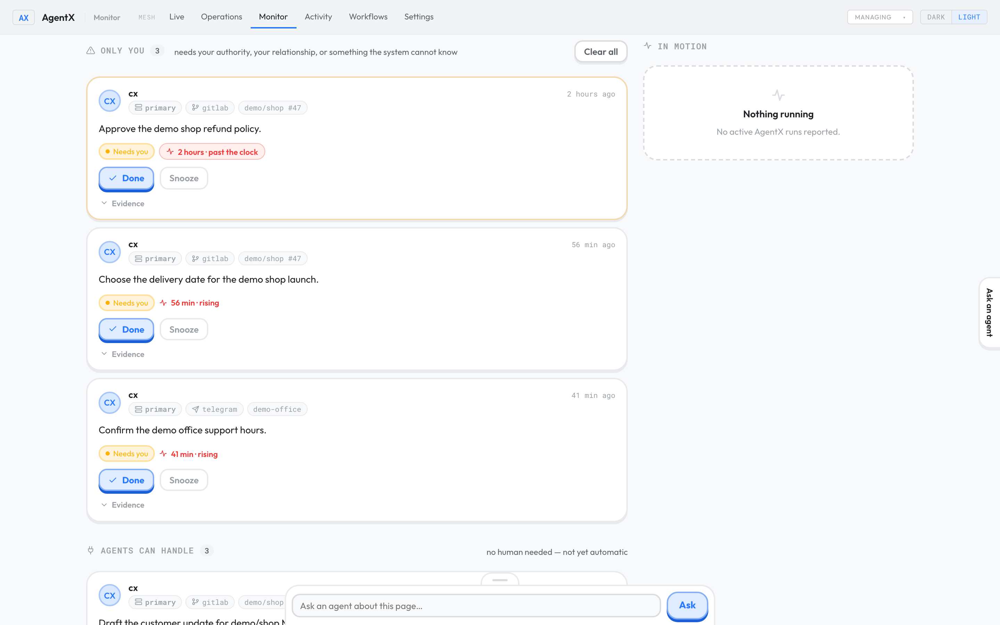
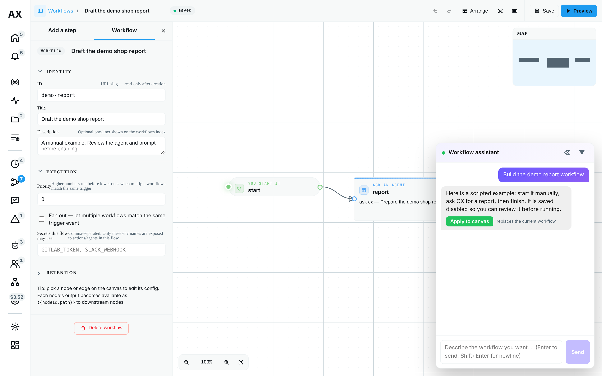

<div align="center">

**English** · [العربية](docs/ar/README.md)


# AgentX

**Put AI agents to work in the tools your team already uses.**

<a href="https://www.producthunt.com/products/agentx-4?embed=true&amp;utm_source=badge-featured&amp;utm_medium=badge&amp;utm_campaign=badge-agentx-5" target="_blank" rel="noopener noreferrer"></a>

[](https://www.npmjs.com/package/agentix-cli)
[](https://github.com/anis-marrouchi/agentx/actions/workflows/ci.yml)
[](LICENSE)
[](package.json)

[Watch it](#watch-it) · [See the demo](#see-it-without-an-account) · [Install](#install) · [Read the guide](docs/index.md)

</div>

1. **Give each agent a job.** For example, a support agent answers customer questions, or a project manager agent writes the daily status report.
2. **It works in your team's tools.** The agent answers in Telegram, WhatsApp, GitLab or GitHub, and runs scheduled work, on a machine you control.
3. **You check the result and decide.** The browser dashboard shows what each agent did, and anything that needs a person waits for you.

AgentX gives each agent its channels, tools, schedules and memory, and records what it did. It works with Claude Code, Codex, OpenCode or any model API.



*The Monitor dashboard in the isolated demo: review tasks that need you, with in-page agent chat. All displayed tasks are fictional.*

## Watch it

Short videos show AgentX running, one task each. Click the picture to open the **Learn AgentX** playlist on YouTube.

[](https://www.youtube.com/playlist?list=PLWyRWfXkYvlw)

- [01: Run AI agents on your own machine, no account](https://youtu.be/J_QC6QCsSBs)
- [02: Install AgentX and check it with doctor](https://youtu.be/arOqm5bB1Lw)
- [Phone part 1: Install the AgentX phone app and pair it](https://youtu.be/i4BNYlI9ntA)
- [Phone part 2: Chat with your AI agents from a phone](https://youtu.be/ofX__nC53ZQ)
- [Desktop part 1: Install the AgentX desktop widget on a Mac](https://youtu.be/XwTJjaTt5WE)
- [Desktop part 2: The floating widget, the pill and the orb](https://youtu.be/catRqT5LoyY)

## See it without an account

With Node.js 22.19 or newer, up to 26 (tested on 22, 24, 25 and 26), run:

```sh
npx agentix-cli demo
```

No clone, account, or API key is needed. The first run downloads the package, which takes a minute or two; `npm warn deprecated` lines during the download are harmless. From a built source checkout, `node dist/cli.js demo` does the same.

The demo starts three local AgentX daemons and sends a task between them. Routing, network calls, and the event record are real. Model responses are scripted, so the demo makes no billable model calls. The terminal prints the dashboard addresses. [What to expect](docs/see-it-first.md).

## What it does

- **Questions get answered where your team works.** Connect a channel and assign its messages to an agent.
- **Recurring work gets done without a reminder.** Ask an agent for a daily report or another recurring task.
- **You can see what happened.** Live shows current work; Activity records completed runs; Monitor shows reviewed work that needs a person and work agents can handle.
- **You reach your agents the way you prefer.** Use [in-page chat](docs/dashboard/chat.md), the [OpenCode-backed TUI](docs/dashboard/tui.md), or the desktop assistant for voice and computer use.
- **Your setup grows across machines.** Start with one host, then pair another when a job needs its tools or files.

## Current state: usable, experimental, not yet stable

AgentX works and can be used today, but it is still an **experimental project, not a stable release**. There is plenty to polish and fix, especially the **Settings experience and configuration flows**. Expect rough edges and changes as people try it in real environments.

Releases ship often; see the [changelog](CHANGELOG.md) for what changed. Our priority is to learn from actual use: what works, what breaks, and what is confusing to set up or operate.

**Still missing: role-based access control (RBAC) at both mesh and agent levels.** We want to define who can access shared nodes and agents, delegate work, and perform particular actions. This would open up more possibilities for shared teams and multi-user deployments. Existing mesh authentication and tool permissions do not provide this complete role model; RBAC is planned work, not an available feature.

[Try the demo](#see-it-without-an-account), [check the requirements](docs/requirements.md), or [help us test](#help-test-and-improve-agentx).

## Describe an automation, get an automation

The Workflows editor has a chat control. Describe the timing, source, and destination in ordinary language. An authoring agent can propose a workflow and show an **Apply to canvas** action. Read the proposed steps before applying them: this replaces the current graph. Real authoring needs a working model. The demo includes a fixed example for **Build the demo report workflow**. [Walk through it](docs/automations/describe-it.md).



## Install

A technical teammate needs a terminal for installation, model setup, and starting the services. The web wizard handles the rest of the initial setup; daily inspection is in the browser. Plan on about 10 to 20 minutes for a first install, plus the time to get a model key. AgentX runs on **macOS and Linux** (Windows is untested; try WSL) and requires **Node.js 22.19 or newer, up to 26**.

```sh
git clone https://github.com/anis-marrouchi/agentx.git
cd agentx
cp .env.example .env
docker compose up --build -d
```

Open **http://127.0.0.1:4202/setup**. Compose builds this checkout and starts both services; its default image uses an API model rather than a preinstalled model CLI.

Without Docker, install Node.js 22.19 or newer (up to 26) and pnpm 10, then build and open the wizard:

```sh
pnpm install
pnpm build
node dist/cli.js setup
```

On a source install, the wizard serves the dashboard and **the daemon is a separate process**. Start it in another terminal, or use the wizard's **Start daemon now** button:

```sh
node dist/cli.js daemon start --detach
node dist/cli.js daemon status
```

The npm package is `agentix-cli`; the installed executable is `agentx`. Follow the [installation guide](docs/install.md) for details.

### Add AgentX to Claude Code

With AgentX installed and its node running, one command adds the AgentX plugin to Claude Code (version 2.1.275 or later). The plugin brings the AgentX tool server, in look-only mode by default, and two skills:

```sh
claude plugin install agentx --marketplace anis-marrouchi/agentx
```

Start a new Claude Code session and ask it to check your AgentX node. [Step-by-step guide and settings](docs/jobs/install-the-plugin.md). For Cursor, VS Code or Windsurf, see [Use AgentX from your code editor](docs/jobs/connect-an-editor.md).

## One machine is enough to start

When an agent needs to work on another machine, pair the nodes with `agentx connect mesh invite` and `agentx connect mesh join <link>`. A connected agent can pass work to another node. For example:

```text
You:     "@cx CI is red on GitLab — find the cause"
CX:      sends the build investigation to @builder on another node
Builder: checks the project and reports the result
CX:      replies in the original thread
```

The [second-machine guide](docs/jobs/second-machine.md) covers pairing. You do not need mesh for a one-agent setup.

## The dashboard

The six top-level tabs are **Live, Operations, Monitor, Activity, Workflows, and Settings**. [Dashboard guide](docs/dashboard/index.md). The dashboard and daemon must both be running for messages to be handled.

## Channels and models

Telegram and WhatsApp have pairing flows. GitLab, GitHub, and generic webhooks can bring in events. **Slack and Discord are not supported as live channel adapters in this build.** [Channel reference](docs/reference/channels.md).

Real agents need a configured model. An API provider needs a key; Claude Code, Codex CLI, and OpenCode need their CLI installed and authenticated on the host. Model-provider charges or subscription terms depend on your chosen provider.

## Integrations

- **Channels:** Telegram, WhatsApp, GitLab, GitHub, and generic webhooks. [Channel reference](docs/reference/channels.md).
- **Models:** API providers, plus the Claude Code, Codex CLI, and OpenCode CLIs.
- **Other programs:** the local daemon accepts tasks over HTTP, and `agentx a2a` serves the A2A protocol. [Agent-to-agent reference](docs/reference/a2a.md).
- **Coding agents:** a [Claude Code plugin](docs/jobs/install-the-plugin.md), and the `agentx serve --stdio` tool server for [Cursor, VS Code and Windsurf](docs/jobs/connect-an-editor.md).
- **Raycast:** ask your agents and list them from Raycast. [Install from this checkout](integrations/raycast/README.md); not in the Raycast Store yet.

## Help test and improve AgentX

The most valuable contribution right now is **trying AgentX and reporting what happens**. You do not need to write code to help.

1. **Test and report issues.** Try installation, Settings, model setup, chat, the desktop assistant, the TUI, or a task across nodes. Report failures and confusing steps, including what you expected and what actually happened.
2. **Help with triage and workflow/pipeline management.** Reproduce reports, identify duplicates, clarify priorities, and help follow issues through fixes, CI, and releases.
3. **Contribute code and documentation.** Fix bugs, improve setup and Settings, clarify instructions, or help design the missing mesh-level and agent-level RBAC. Discuss larger changes in an issue first.

[Report an issue](https://github.com/anis-marrouchi/agentx/issues/new/choose) yourself, or let your own agent help you draft it with [`agentx contribute`](docs/guides/contribute.md). Include your version, operating system, steps to reproduce, and relevant logs or screenshots. Remove secrets and private data before sharing. Report security vulnerabilities through the [security policy](SECURITY.md).

See [Contributing](CONTRIBUTING.md) for testing, issue triage, and development instructions.

### Most requested

Give a 👍 to the open requests you care about; the community decides together what matters most. This list is updated every day.

<!-- most-requested:start -->
No request has 5 votes yet. Yours could be the first: give a 👍 to the issues you care about.

[Full ranked list](https://agentx-docs.pages.dev/community/most-requested) · [How voting works](https://agentx-docs.pages.dev/guides/contribute)
<!-- most-requested:end -->

## Sponsors

We are grateful for the support of our sponsors, who help make AgentX possible.

<p align="center">
  <a href="https://noqta.tn"></a>
</p>

Want to sponsor AgentX? [Start a discussion](https://github.com/anis-marrouchi/agentx/discussions) and we will add you here.

## Help and development

- [Start here](docs/index.md) · [Troubleshooting](docs/help/its-not-answering.md) · [CLI reference](docs/reference/cli.md)
- [Support and supported environments](.github/SUPPORT.md) · [Ask a question](https://github.com/anis-marrouchi/agentx/discussions)
- [Contributing](CONTRIBUTING.md) · [Security policy](SECURITY.md) · [Changelog](CHANGELOG.md)

AgentX is released under the [MIT License](LICENSE).
