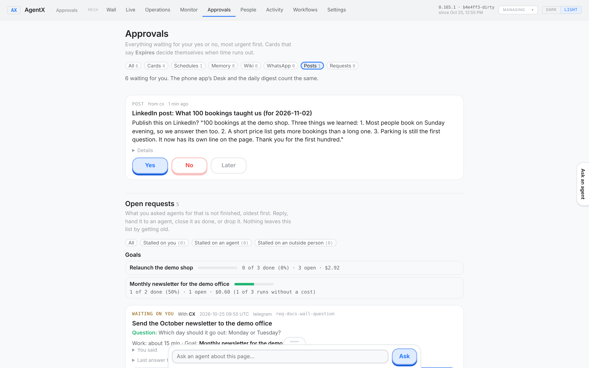
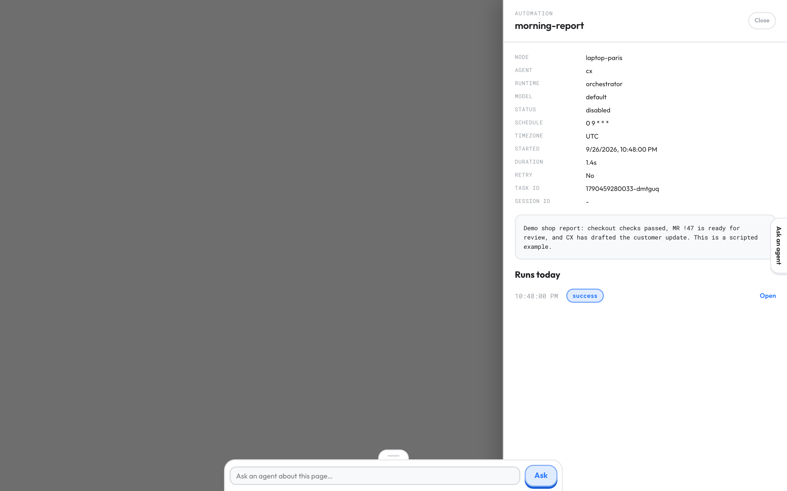
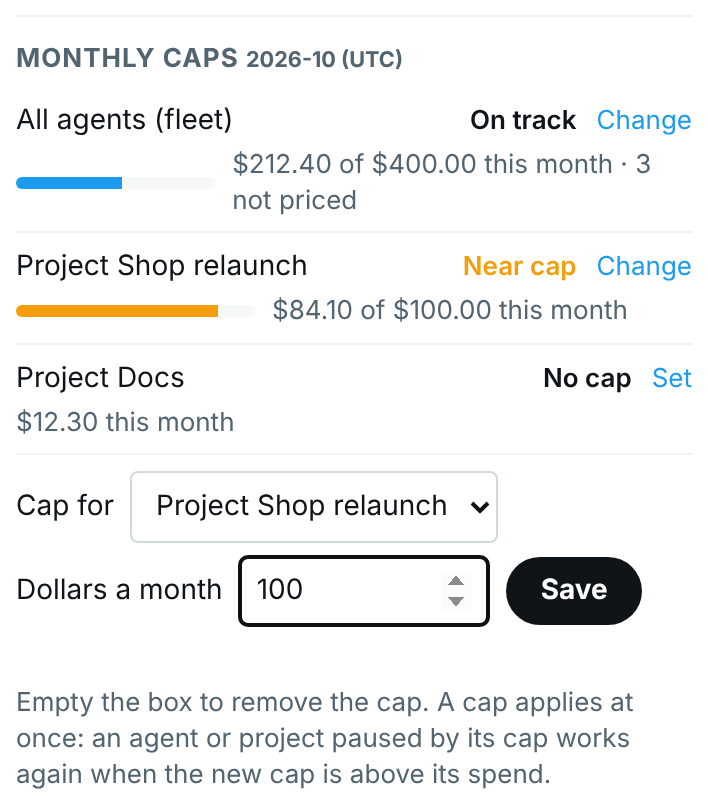

<div align="center">

**English** · [العربية](docs/ar/README.md)


# AgentX

**AI staff for a small company: they find sales, answer clients, write your posts and watch the money, on a machine you own. You approve what matters.**

<a href="https://www.producthunt.com/products/agentx-4?embed=true&amp;utm_source=badge-featured&amp;utm_medium=badge&amp;utm_campaign=badge-agentx-5" target="_blank" rel="noopener noreferrer"></a>

[](https://www.npmjs.com/package/agentix-cli)
[](https://github.com/anis-marrouchi/agentx/actions/workflows/ci.yml)
[](LICENSE)
[](package.json)
[](https://github.com/anis-marrouchi/agentx/actions/workflows/install-matrix.yml)

[The jobs](#the-jobs-agentx-does) · [Your questions](#your-questions-answered) · [See the demo](#see-it-without-an-account) · [Install](#install) · [How it works](#how-it-works)

</div>

1. **Give each agent a job.** Answer clients, send the daily report, or work on an issue.
2. **It works in your team's tools.** WhatsApp, Telegram, GitLab, GitHub and schedules, on a machine you own.
3. **You check the result and decide.** The browser dashboard shows what was done and what still needs you.

## What you get

- **More sales.** New leads every week, a morning brief on what changed, and a ready follow-up for every lead that went quiet.
- **Faster replies to clients.** A client who writes on WhatsApp after hours gets an answer within a minute, and each evening you see who still waits on you.
- **Content that goes out on time.** Next week's posts are planned on Friday and drafted in your voice on Monday. You say yes before anything is published.
- **Money under control.** A monthly dollar cap per agent, per project and for the whole company. You are warned at 80% and the work pauses at 100%.
- **Operations that report only problems.** One message a day lists what failed, what is stuck and what is paused. When nothing is wrong, nothing is sent.

Each job comes as a **ready-made team**: agents with their instructions and their schedules (tasks that run by themselves at set times), added in one command. You connect your chat app, and the first result arrives on the next scheduled run. [Start from a ready-made team](docs/jobs/ready-made-teams.md).

## The jobs AgentX does

One section per job a small company hires for. Each says what you approve, what it costs, and the first result you can check.

What it costs depends on your model account (a Claude subscription, or an API key you pay by use). AgentX itself is free. A **run** is one time an agent works: it reads, thinks and answers. Each run uses your model account. [What it costs](docs/help/costs.md).

### Sales

**The problem.** Leads come in, then go quiet because nobody followed up. Nobody has time to research new prospects or watch what competitors change.

**What AgentX does.** The `sales-follow-up` team finds up to 10 new leads a week that match the customers you describe, sends you a brief every weekday morning, watches your competitors' pages and reports only what changed, and drafts a follow-up for each quiet lead. Every fact links to the page it came from. People who asked not to be contacted are left out.

**What you approve.** Everything that reaches a person. The agent cannot send anything: you read each draft and send it yourself.

**What it costs.** About 12 runs a week (5 page checks, 5 briefs, 1 research list, 1 set of drafts), plus the questions you ask it.

**First result you can see.** **Terminal:** in `agents/sales/`, `agentx sales watch` lists the competitor pages it now watches. The next weekday after 08:30, the brief arrives in Telegram, every line with a link.

[Find and follow up sales leads](docs/jobs/sales.md)

### Content

**The problem.** Posts go out late or not at all, and when someone else writes them they do not sound like you.

**What AgentX does.** The `content` team learns your voice from a folder of your past posts, plans next week's posts every Friday, and drafts each one on Monday, naming the past posts it followed. It posts to LinkedIn or X, or saves the post ready to paste.

**What you approve.** Every post. Nothing is published until you say yes in **Approvals**.

**What it costs.** Two runs a week, plus the drafts you ask for.

**First result you can see.** **Terminal:** `agentx content drafts` lists one draft per planned post, each with the past posts it followed.



[Draft posts in your voice](docs/jobs/content.md)

### Clients and support

**The problem.** Clients write after hours and wait until morning, then ask again where their request stands.

**What AgentX does.** The `client-inbox` team answers on WhatsApp from your business notes, within a minute, and hands you prices, refunds, complaints and dates it cannot decide. Each evening you get the list of clients still waiting on you. An agent can answer on Telegram the same way. Each client can get a page of their own that shows what they asked for and where it stands.

**What you approve.** Replies go out **without** your approval, so use a separate number and give the agent clear notes on what it may promise. It passes anything it cannot decide to you. If you prefer to approve every reply, [watch a WhatsApp chat](docs/jobs/watch-whatsapp.md) instead: the agent drafts and nothing is sent until you say yes.

**What it costs.** One run per client message, plus one summary each weekday evening.

**First result you can see.** **Phone:** write to the paired number from an allowed number. The answer arrives in the same chat within a minute.

**Support from your own documents, by email too.** The `support` team answers from a folder of your guides and policies and ends each answer with the document it came from. Questions the documents don't cover come to you instead of being guessed. Connect a mailbox and it answers email in the same thread; each email reply waits in **Approvals** until you send it.

[Answer customers on WhatsApp](docs/jobs/answer-whatsapp.md) · [Answer customer email](docs/jobs/answer-email.md) · [Start from a ready-made team](docs/jobs/ready-made-teams.md) · [Give a client a page](docs/jobs/clients.md)

### Operations

**The problem.** Reports depend on someone remembering them, and automated checks that say "all fine" every day soon get ignored.

**What AgentX does.** A schedule asks an agent for the daily report at a set time. A check can stay quiet unless it finds a problem. The **exceptions digest** sends one message a day that lists failed or missed schedules, stuck requests and paused agents, and nothing when all is well.

**What you approve.** A new or removed schedule waits for your yes when an agent proposes it.

**What it costs.** One run per scheduled report. The exceptions digest uses no model, so it costs nothing.

**First result you can see.** **Browser:** open the dashboard, select **Operations**, and find your schedule under **Today's automations**, with each run and its result.



[Send a daily report](docs/jobs/daily-report.md) · [Get a daily list of what is wrong](docs/jobs/exceptions-digest.md) · [Operations page](docs/dashboard/operations.md)

### Money

**The problem.** AI spend can grow without anyone noticing until the bill arrives.

**What AgentX does.** You set a monthly dollar budget for an agent, a project, or all agents together. At 80% you get one notice. At 100% new work for that agent pauses and waits; it runs on the first day of the next month, or as soon as you raise the budget. Waiting messages survive a restart. The Cost page shows what each agent spent.

**What you approve.** You set the caps and raise them. Nothing raises a cap by itself.

**What it costs.** Nothing: counting and caps run on your machine.

**First result you can see.** **Browser:** open your dashboard and select **Cost** in the Wall's nav. Each agent's row shows its spend against its cap, and **Monthly caps** shows the fleet and each project.



[Set a monthly budget](docs/help/costs.md#set-a-monthly-budget-for-an-agent)

### Dev

**The problem.** Small code fixes wait days for a developer, and code an agent wrote can pass its own tests and still miss the point.

**What AgentX does.** The `dev-team` team turns an issue you assign on GitLab into a small merge request with a test, and a second agent reviews it. On GitHub, the review gate checks each agent pull request against its issue before merge, and the same works on GitLab merge requests. Issues can come from Linear or Jira. Turn on worktrees and each issue gets its own folder, so two tasks on the same project do not mix.

**What you approve.** The merge. Neither agent merges.

**What it costs.** One run per issue and per review, plus one digest each weekday morning.

**First result you can see.** **Browser:** on the pull request, the check `agentx/review` shows **success** or **failure**, with a comment that lists what is missing.

[Watch GitLab work](docs/jobs/watch-gitlab.md) · [Review gate](docs/jobs/review-gate.md) · [Linear and Jira](docs/jobs/linear-jira.md) · [One folder per task](docs/jobs/task-worktrees.md)

## Your questions, answered

**Can the bill run away?** Not if you set a cap. A monthly budget pauses an agent, a project or the whole company at the amount you set. Without a cap, spend follows your use; start with schedules that run rarely. [Costs and caps](docs/help/costs.md).

**Will it send or publish something without me?** Sales messages are only drafts: you send them yourself. Content posts, email replies, replies in a watched WhatsApp chat, new schedules and a few other actions wait for your yes in **Approvals**. Some things go out on their own: answers on a WhatsApp or Telegram number you connected to an agent, and comments on issues. [What always waits for you](docs/jobs/keep-it-safe.md#what-always-waits-for-you) lists both, plainly.

**Where does my data go?** AgentX runs on your machine. The AI model belongs to a model provider (for example Anthropic or OpenAI), so what an agent reads to answer goes there. Nothing goes to the makers of AgentX: no usage statistics. [Your data](docs/your-data.md) lists everything that leaves, and how to keep it home.

**What happens when something fails?** A failed scheduled run sends a short failure message to its chat, and the exceptions digest lists it the next day. A task you stop keeps a plan and can be resumed. A restart lets running tasks finish first, and messages paused by a budget are kept. [Daily list of what is wrong](docs/jobs/exceptions-digest.md) · [Restart without losing work](docs/jobs/restart-safely.md) · [Pause and resume](docs/jobs/pause-and-resume.md).

## Is AgentX right for you?

**Right for you if:**

- your clients or your team already work in WhatsApp, Telegram, email, GitLab or GitHub;
- you want the agents, and what they see, on a machine you control ([your data](docs/your-data.md));
- you have someone who can run one command in a terminal to install it;
- you already use Claude Code, Codex, OpenCode or a model API key ([what it costs](docs/help/costs.md)).

**Not for you yet if:**

- you need Slack or Discord as a live channel ([channels](docs/reference/channels.md));
- you need roles and permissions for many users (not built yet);
- you want a hosted service with nothing to install: there is none;
- you run Windows only (untested; WSL may work);
- you need a 1.0 release: AgentX is still 0.x because there is still work to do. The [upgrade promise](docs/reference/releases.md#upgrade-promise) already holds.

## See it without an account

With Node.js 22.19 or newer, up to 26 (tested on 22, 24, 25 and 26), run:

```sh
npx agentix-cli demo
```

No clone, account, or API key is needed. The first run downloads the package, which takes a minute or two; `npm warn deprecated` lines during the download are harmless. From a built source checkout, `node dist/cli.js demo` does the same.

The demo starts three local AgentX daemons and sends a task between them. Routing, network calls, and the event record are real. Model responses are scripted, so the demo makes no billable model calls. The terminal prints the dashboard addresses. [What to expect](docs/see-it-first.md).


*The Monitor dashboard in the isolated demo: review tasks that need you, with in-page agent chat. All displayed tasks are fictional.*

## Watch it

Short videos show AgentX running, one task each. Click the picture to open the **Learn AgentX** playlist on YouTube.

[](https://www.youtube.com/playlist?list=PLWyRWfXkYvlw)

- [01: Run AI agents on your own machine, no account](https://youtu.be/J_QC6QCsSBs)
- [02: Install AgentX and check it with doctor](https://youtu.be/arOqm5bB1Lw)
- [Phone part 1: Install the AgentX phone app and pair it](https://youtu.be/i4BNYlI9ntA)
- [Phone part 2: Chat with your AI agents from a phone](https://youtu.be/ofX__nC53ZQ)
- [Desktop part 1: Install the AgentX desktop widget on a Mac](https://youtu.be/XwTJjaTt5WE)
- [Desktop part 2: The floating widget, the pill and the orb](https://youtu.be/catRqT5LoyY)

## Install

One command, on macOS or Linux with **Node.js 22.19 or newer, up to 26**:

```sh
npx agentix-cli start
```

It creates `agentx.json` with one agent in the current folder, starts AgentX in the background, and ends with your first agent's chat open in the browser. From typing the command to the first reply took about 23 seconds on Linux and 24 seconds on macOS (median of 3 runs each, model key ready); an automated check times it on Linux and macOS on every change and fails above 5 minutes. If no model is set up yet, the chat asks for an API key, or for the Claude Code login, and then answers. Run it again any time: it reuses what is running and never overwrites your config. Windows is untested; try WSL.

Then add the team for the job you want, for example:

```sh
agentx team add sales-follow-up
```

To install the `agentx` command globally first, use the installer, which checks Node.js (and downloads Node 22 into `~/.agentx/node` when it is missing) and then runs the same start:

```sh
curl -fsSL https://raw.githubusercontent.com/anis-marrouchi/agentx/main/install.sh | bash
```

With Docker instead (its default image uses an API model rather than a preinstalled model CLI):

```sh
git clone https://github.com/anis-marrouchi/agentx.git
cd agentx
cp .env.example .env
docker compose up --build -d
```

Then open **http://127.0.0.1:4202/setup**. From a source checkout, with pnpm 10:

```sh
pnpm install
pnpm build
node dist/cli.js start
```

The npm package is `agentix-cli`; the installed executable is `agentx`. Follow the [installation guide](docs/install.md) for details.

## How it works

The rest of this page is for the person who sets AgentX up.

AgentX is a **harness**: the program around an AI model that gives it channels, tools, schedules and memory, and records what it did. It runs on Claude Code, Codex, OpenCode or any model API, on a machine you control. A background service, the **daemon**, receives messages and runs the agents; the **dashboard** in your browser shows what was done and what still needs you. Both must be running for messages to be handled.

### The dashboard

The six top-level tabs are **Live, Operations, Monitor, Activity, Workflows, and Settings**. Live shows current work; Activity records completed runs; Monitor shows reviewed work that needs a person and work agents can handle. You can also reach your agents with [in-page chat](docs/dashboard/chat.md), the [OpenCode-backed TUI](docs/dashboard/tui.md), or the desktop assistant for voice and computer use. [Dashboard guide](docs/dashboard/index.md).

### Describe an automation, get an automation

The Workflows editor has a chat control. Describe the timing, source, and destination in ordinary language. An authoring agent can propose a workflow and show an **Apply to canvas** action. Read the proposed steps before applying them: this replaces the current graph. Real authoring needs a working model. The demo includes a fixed example for **Build the demo report workflow**. [Walk through it](docs/automations/describe-it.md).


### Channels and models

Telegram and WhatsApp have pairing flows. GitLab, GitHub, and generic webhooks can bring in events. **Slack and Discord are not supported as live channel adapters in this build.** [Channel reference](docs/reference/channels.md).

Real agents need a configured model. An API provider needs a key; Claude Code, Codex CLI, and OpenCode need their CLI installed and authenticated on the host. Model-provider charges or subscription terms depend on your chosen provider.

### One machine is enough to start

When an agent needs to work on another machine, pair the nodes with `agentx connect mesh invite` and `agentx connect mesh join <link>`. Paired machines form a **mesh**, and a connected agent can pass work to another node. For example:

```text
You:     "@cx CI is red on GitLab — find the cause"
CX:      sends the build investigation to @builder on another node
Builder: checks the project and reports the result
CX:      replies in the original thread
```

The [second-machine guide](docs/jobs/second-machine.md) covers pairing. You do not need a mesh for a one-agent setup.

### Integrations

- **Channels:** Telegram, WhatsApp, GitLab, GitHub, and generic webhooks. [Channel reference](docs/reference/channels.md).
- **Models:** API providers, plus the Claude Code, Codex CLI, and OpenCode CLIs.
- **Other programs:** the local daemon accepts tasks over HTTP, and `agentx a2a` serves the A2A protocol. [Agent-to-agent reference](docs/reference/a2a.md).
- **Coding agents:** a [Claude Code plugin](docs/jobs/install-the-plugin.md), and the `agentx serve --stdio` tool server (MCP) for [Cursor, VS Code and Windsurf](docs/jobs/connect-an-editor.md).
- **Raycast:** ask your agents and list them from Raycast. [Install from this checkout](integrations/raycast/README.md); not in the Raycast Store yet.

### Add AgentX to Claude Code

With AgentX installed and its node running, one command adds the AgentX plugin to Claude Code (version 2.1.275 or later). The plugin brings the AgentX tool server, in look-only mode by default, and two skills:

```sh
claude plugin install agentx --marketplace anis-marrouchi/agentx
```

Start a new Claude Code session and ask it to check your AgentX node. [Step-by-step guide and settings](docs/jobs/install-the-plugin.md). For Cursor, VS Code or Windsurf, see [Use AgentX from your code editor](docs/jobs/connect-an-editor.md).

### Release status

AgentX is used every day and releases ship often; see the [changelog](CHANGELOG.md) for what changed. It works, but it stays on 0.x for now because there is still work to do; there is no date for 1.0 yet. A breaking change is always listed in the changelog with what to do, each release is installed on Linux and macOS by the install matrix (its pass rate is the badge at the top), and the [roadmap](docs/roadmap.md) says what comes next. See [Releases, upgrades and security](docs/reference/releases.md).

**Not built yet: roles and permissions (RBAC) for shared machines and agents.** Mesh authentication and tool permissions exist, but there is no full role model for who may use which node or agent. It is planned, not available.

## Help test and improve AgentX

The most valuable contribution right now is **trying AgentX and reporting what happens**. You do not need to write code to help.

1. **Test and report issues.** Try installation, Settings, model setup, chat, the desktop assistant, the TUI, or a task across nodes. Report failures and confusing steps, including what you expected and what actually happened.
2. **Help with triage and workflow/pipeline management.** Reproduce reports, identify duplicates, clarify priorities, and help follow issues through fixes, CI, and releases.
3. **Contribute code and documentation.** Fix bugs, improve setup and Settings, clarify instructions, or help design the missing mesh-level and agent-level RBAC. Discuss larger changes in an issue first.

[Report an issue](https://github.com/anis-marrouchi/agentx/issues/new/choose) yourself, or let your own agent help you draft it with [`agentx contribute`](docs/guides/contribute.md). Include your version, operating system, steps to reproduce, and relevant logs or screenshots. Remove secrets and private data before sharing. Report security vulnerabilities through the [security policy](SECURITY.md).

See [Contributing](CONTRIBUTING.md) for testing, issue triage, and development instructions.

### Most requested

Give a 👍 to the open requests you care about; the community decides together what matters most. This list is updated every day.

<!-- most-requested:start -->
No request has 5 votes yet. Yours could be the first: give a 👍 to the issues you care about.

[Full ranked list](https://agentx-docs.pages.dev/community/most-requested) · [How voting works](https://agentx-docs.pages.dev/guides/contribute)
<!-- most-requested:end -->

## Sponsors

We are grateful for the support of our sponsors, who help make AgentX possible.

<p align="center">
  <a href="https://noqta.tn"></a>
</p>

Want to sponsor AgentX? [Start a discussion](https://github.com/anis-marrouchi/agentx/discussions) and we will add you here.

## Help and development

- [Start here](docs/index.md) · [Troubleshooting](docs/help/its-not-answering.md) · [CLI reference](docs/reference/cli.md)
- [Support and supported environments](.github/SUPPORT.md) · [Ask a question](https://github.com/anis-marrouchi/agentx/discussions)
- [Contributing](CONTRIBUTING.md) · [Security policy](SECURITY.md) · [Changelog](CHANGELOG.md)

AgentX is released under the [MIT License](LICENSE).
