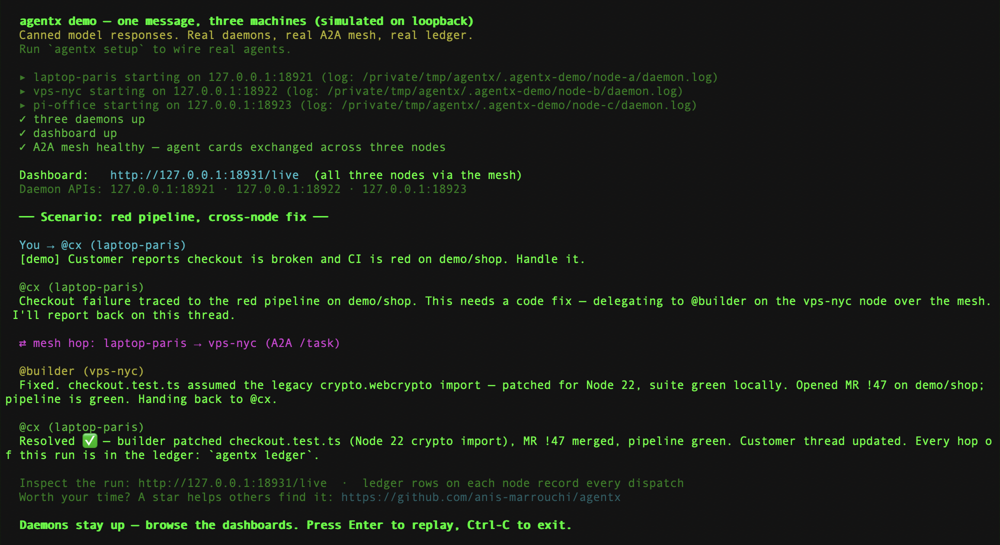
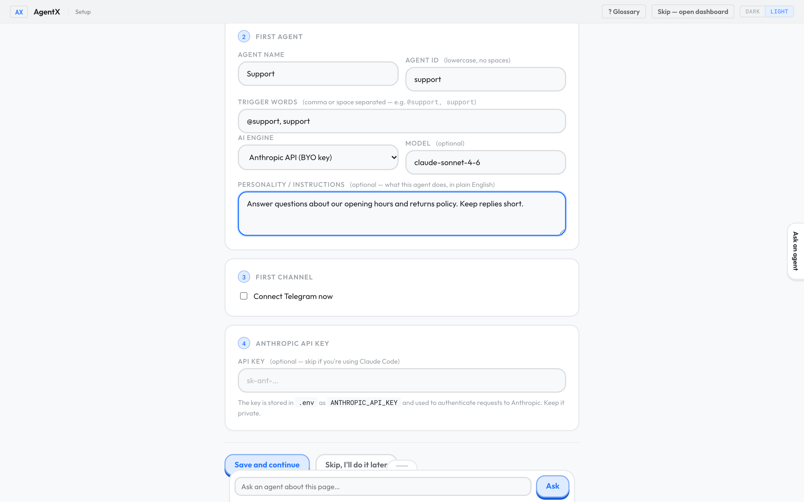

<div dir="rtl" lang="ar">

# AgentX

[English](https://github.com/anis-marrouchi/agentx#readme) · **العربية**

**منصّة تشغيل الوكلاء (agent harness) المستضافة ذاتيًا للفرق الصغيرة.**

AgentX هو برنامج تشغّله على أجهزتك أنت (مستضاف ذاتيًا)، ويدير فريقًا من وكلاء الذكاء الاصطناعي عبر قنوات المحادثة التي يستخدمها فريقك أصلًا. **الوكيل** برنامج ذكاء اصطناعي تُسند إليه مهمة محدّدة. و**منصّة التشغيل** (harness) هي البرنامج الذي يحيط بنماذج الذكاء الاصطناعي: تعطي كل وكيل مهمته وأدواته وجدوله الزمني، وتوصل إليه الرسائل الموجّهة إليه، وتسجّل ما فعله.

اربط Telegram أو WhatsApp أو GitLab أو GitHub أو webhook (عنوان ويب يستقبل الأحداث من برنامج آخر). أعطِ كل وكيل مهمة واضحة. وتابع النتيجة في لوحة تحكّم داخل المتصفّح.

> AgentX يعمل ويمكن استخدامه اليوم، لكنه **مشروع تجريبي وليس إصدارًا مستقرًا بعد**. توقّع بعض النقص والتغييرات، خاصة في صفحة الإعدادات.

## ماذا يفعل

- **يجيب حيث يعمل فريقك.** اربط قناة وأسند رسائلها إلى وكيل.
- **ينفّذ أعمالًا مجدولة.** اطلب من وكيل تقريرًا يوميًا أو أي مهمة متكرّرة.
- **يريك ما حدث.** صفحة Live تعرض العمل الجاري، وActivity تسجّل ما انتهى، وMonitor تعرض ما يحتاج إلى شخص.
- **يكبر عبر الأجهزة.** ابدأ بجهاز واحد، ثم أضف جهازًا آخر عندما تحتاج مهمة إلى أدواته أو ملفاته.

## جرّبه دون حساب

العرض التجريبي يشغّل ثلاثة وكلاء على جهازك بردود مكتوبة مسبقًا، فلا يحتاج إلى حساب ولا إلى مفتاح نموذج ولا يكلّف شيئًا. تحتاج إلى Node.js من الإصدار 22.19 حتى 26.

1. **في الطرفية (Terminal):** شغّل هذا الأمر:

<div dir="ltr">

```sh
npx agentix-cli demo
```

</div>

2. **في الطرفية:** انتظر حتى يطبع الأمر عناوين لوحة التحكّم. التشغيل الأول ينزّل الحزمة ويستغرق دقيقة أو دقيقتين.
3. **في المتصفّح:** افتح العنوان الذي طبعته الطرفية.



التفاصيل في [ماذا تتوقّع من العرض التجريبي](../see-it-first.md) (بالإنجليزية).

## التثبيت

يعمل AgentX على **macOS وLinux**. يحتاج التثبيت الأول إلى ما بين 10 و20 دقيقة، إضافة إلى وقت الحصول على مفتاح نموذج.

1. **في الطرفية:** نزّل المشروع وشغّله بـ Docker:

<div dir="ltr">

```sh
git clone https://github.com/anis-marrouchi/agentx.git
cd agentx
cp .env.example .env
docker compose up --build -d
```

</div>

2. **في المتصفّح:** افتح `http://127.0.0.1:4202/setup`.
3. **في المتصفّح:** اتبع معالج الإعداد: اختر نموذجًا، ثم أنشئ أول وكيل.



للتثبيت دون Docker وللتفاصيل، راجع [دليل التثبيت](../install.md) (بالإنجليزية).

## أضف AgentX إلى Claude Code

Claude Code مساعد برمجة يعمل في الطرفية. أمر واحد يثبّت فيه حزمة مهارات AgentX: ثلاث **مهارات** (ملفات تعليمات قصيرة تعلّم المساعد مهمة واحدة) وخادم أدوات agentx، الذي يكتفي بالاطّلاع على جهازك حتى تسمح له بالمزيد.

1. **في الطرفية:** شغّل هذا الأمر:

<div dir="ltr">

```sh
claude plugin install agentx --marketplace anis-marrouchi/agentx
```

</div>

2. **في الطرفية:** ابدأ جلسة Claude Code جديدة بالأمر `claude`.
3. اسأل Claude Code: "Is my AgentX node healthy?"

الخطوات كاملة في [تثبيت حزمة مهارات AgentX](../jobs/install-skill-pack.md) (بالإنجليزية).

## ساعد في الاختبار والتحسين

أهمّ مساهمة الآن هي **تجربة AgentX والإبلاغ عمّا يحدث**. لا تحتاج إلى كتابة أي شيفرة.

1. جرّب التثبيت أو الإعدادات أو المحادثة.
2. افتح [بلاغًا على GitHub](https://github.com/anis-marrouchi/agentx/issues/new/choose): ماذا توقّعت، وماذا حدث فعلًا، ورقم الإصدار ونظام التشغيل.
3. احذف أي كلمة سر أو بيانات خاصة قبل المشاركة.

## تحقّق من أنه يعمل

1. **في الطرفية:** شغّل `npx agentix-cli --version`. يجب أن يطبع رقم الإصدار.
2. **في المتصفّح:** افتح لوحة التحكّم. يجب أن ترى تبويبات Live وOperations وMonitor وActivity وWorkflows وSettings.

## إذا حدث خطأ

- **رسالة عن إصدار Node.js.** ثبّت Node.js من الإصدار 22.19 حتى 26، ثم أعد المحاولة.
- **لا تفتح لوحة التحكّم.** تأكّد أن الأمر ما زال يعمل في الطرفية، وأنك نسخت العنوان كما طُبع.
- **الوكيل لا يجيب.** راجع [الوكيل لا يجيب](../help/its-not-answering.md) (بالإنجليزية).
- **سؤال آخر.** اسأل في [النقاشات على GitHub](https://github.com/anis-marrouchi/agentx/discussions).

</div>
