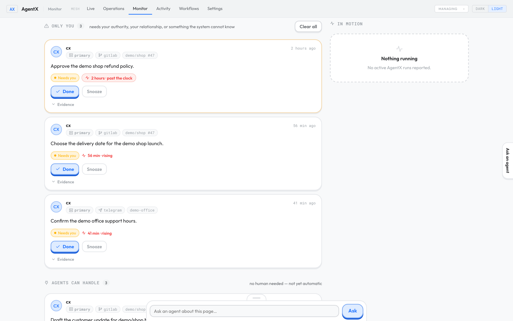

<div dir="rtl">

[English](https://github.com/anis-marrouchi/agentx#readme) · **العربية**

# AgentX

**اجعل وكيل البرمجة الذي تستخدمه أصلًا في الخدمة على الدوام: يردّ في المحادثات وعلى المهامّ البرمجية، ويعمل في مواعيد مجدولة، ويسألك قبل أيّ شيء مهمّ، على جهاز تملكه أنت.**

[لماذا](#لماذا-يوجد-agentx) · [جرّب العرض](#جرّبه-دون-حساب) · [ما قسناه](#ما-قسناه) · [المهامّ](#المهامّ-التي-يقوم-بها-agentx) · [التثبيت](#التثبيت) · [كيف يعمل](#كيف-يعمل)

أدوات مثل Claude Code وCodex وOpenCode تنجز عملًا حقيقيًا، لكن فقط وأنت جالس أمام الطرفية. AgentX يُبقيها تعمل وأنت غائب:

1. **أعطِ كلّ وكيل مهمّة.** الردّ على العملاء، أو إرسال التقرير اليومي، أو العمل على مهمّة برمجية.
2. **يعمل في أدوات فريقك.** WhatsApp وTelegram وGitLab وGitHub والمواعيد المجدولة، على جهاز تملكه أنت.
3. **تراجع النتيجة وتقرّر.** تعرض لوحة التحكّم في المتصفّح ما أُنجز وما زال يحتاج إليك.

جرّبه الآن. دون حساب، ودون مفتاح API، ودون أيّ استدعاء مدفوع لنموذج:

</div>

```sh
npx agentix-cli demo
```

<div dir="rtl">

> هذه الصفحة ترجمة للملف [README بالإنجليزية](https://github.com/anis-marrouchi/agentx#readme). الدليل الكامل متاح بالإنجليزية في [موقع التوثيق](https://agentx-docs.pages.dev/).

## لماذا يوجد AgentX

لوكيل البرمجة في الطرفية أربعة حدود. AgentX يزيل كلّ واحد منها، ولا يضيف شيئًا آخر عليك أن تتعلّمه أوّلًا.

| الحدّ | ما يضيفه AgentX |
|---|---|
| يعمل فقط عندما تكتب إليه. | **القنوات.** رسالة على WhatsApp أو Telegram، أو مهمّة (issue) على GitLab أو GitHub، تبدأ العمل. ويعود الجواب إلى المكان نفسه. |
| لا يفعل شيئًا من تلقاء نفسه. | **المواعيد المجدولة.** مهمّة تعمل في وقت محدّد: ملخّص صباحي، أو تقرير يومي، أو فحص يبقى صامتًا ما لم يجد مشكلة. |
| ينفّذ، أو يتوقّف وينتظر عند سؤال لا يراه أحد. | **الموافقات.** العمل الذي يصل إلى شخص أو يغيّر شيئًا ينتظر في قائمة واحدة حتى توافق. [ما ينتظرك دائمًا](../jobs/keep-it-safe.md#what-always-waits-for-you). |
| ترى الفاتورة في آخر الشهر. | **الميزانيات.** سقف شهري بالدولار لكلّ وكيل ولكلّ مشروع ولكلّ الوكلاء معًا. يصلك تنبيه عند 80%، ويتوقّف العمل الجديد عند 100%. [التكاليف والسقوف](../help/costs.md). |

كلّ ما قام به وكيل يُسجَّل ويظهر في لوحة التحكّم. يعمل AgentX على جهازك، بحساب النموذج الذي لديك أصلًا. ولا يذهب شيء إلى صانعي AgentX. [بياناتك](../your-data.md).

## جرّبه دون حساب

تحتاج إلى Node.js بإصدار 22.19 أو أحدث، حتى 26 (مُختبر على 22 و24 و25 و26). شغّل في الطرفية:

</div>

```sh
npx agentix-cli demo
```

<div dir="rtl">

يشغّل العرض ثلاث نسخ محلية من خدمة AgentX (الخدمة التي تعمل في الخلفية وتشغّل الوكلاء) ويرسل مهمّة بينها. التوجيه والاتصالات الشبكية وسجلّ الأحداث حقيقية، أمّا ردود النموذج فمكتوبة مسبقًا، لذلك لا يُجري العرض أيّ استدعاء مدفوع لنموذج. تطبع الطرفية عناوين لوحة التحكّم. يُنزّل التشغيل الأوّل الحزمة، ويستغرق ذلك دقيقة أو اثنتين. [ماذا تتوقّع](../see-it-first.md).



*صفحة Monitor في العرض المعزول. كلّ المهامّ المعروضة خيالية.*

مقاطع قصيرة تعرض مهمّة واحدة في كلّ مقطع (بالإنجليزية): [قائمة التشغيل **Learn AgentX** على YouTube](https://www.youtube.com/playlist?list=PLWyRWfXkYvlw).

## ما قسناه

ننشر الأرقام، ومنها ما ليس في صالحنا.

| السؤال | النتيجة | المصدر |
|---|---|---|
| كم يمرّ من الوقت بين أمر التثبيت وأوّل ردّ؟ | نحو 23 ثانية على Linux و24 ثانية على macOS (الوسيط لثلاث محاولات لكلّ منهما، ومفتاح النموذج جاهز). يقيس فحص آلي هذا الوقت مع كلّ تغيير ويفشل إذا تجاوز 5 دقائق. | [فحص أوّل ردّ](https://github.com/anis-marrouchi/agentx/actions/workflows/first-reply.yml) |
| كم يكلّف AgentX زيادةً على الوكيل نفسه وحده؟ | على Sonnet 5.5، بثلاث مهامّ برمجية وعشر محاولات لكلّ طريقة: **2% أكثر** بالوضع الخفيف (lean) و**22% أكثر** بالوضع الكامل (full). وعلى Haiku 4.5: لا فرق واضح. كلّ المحاولات كانت صحيحة في الجهتين. | [المقارنة](https://github.com/anis-marrouchi/agentx/blob/main/bench/results/claude-code-comparison-455.md) |
| كم يضيف AgentX من السياق قبل أن يبدأ النموذج؟ | احسبه بنفسك من نسخة مصدرية، دون أيّ استدعاء لنموذج: `pnpm bench:context`. | [القياسات](https://github.com/anis-marrouchi/agentx/blob/main/bench/README.md) |

يُستخدم AgentX كلّ يوم. و[سجلّ التغييرات](https://github.com/anis-marrouchi/agentx/blob/main/CHANGELOG.md) يذكر كلّ إصدار.

## المهامّ التي يقوم بها AgentX

تأتي كلّ مهمّة على شكل **فريق جاهز**: وكلاء مع تعليماتهم ومواعيدهم المجدولة، تُضاف بأمر واحد. [ابدأ من فريق جاهز](../jobs/ready-made-teams.md).

### التطوير

مهمّة (issue) تسندها على GitLab تعود طلب دمج صغيرًا مع اختبار، ويراجعه وكيل ثانٍ. وعلى GitHub، تتحقّق بوابة المراجعة من كلّ طلب سحب (pull request) يفتحه وكيل مقارنةً بمهمّته قبل الدمج. **ما توافق عليه:** الدمج. لا يدمج أيّ من الوكيلين.

[راقب العمل في GitLab](../jobs/watch-gitlab.md) · [بوابة المراجعة](../jobs/review-gate.md) · [مجلّد لكلّ مهمّة](../jobs/task-worktrees.md)

### العملاء والدعم

العميل الذي يكتب على WhatsApp بعد ساعات العمل يحصل على ردّ من ملاحظات عملك خلال دقيقة. الأسعار والمبالغ المستردّة والشكاوى والمواعيد تُحال إليك. **ما توافق عليه:** لا شيء افتراضيًا، لذلك استخدم رقمًا منفصلًا. وللموافقة على كلّ ردّ، [راقب محادثة WhatsApp](../jobs/watch-whatsapp.md) بدلًا من ذلك.

[الردّ على العملاء في WhatsApp](../jobs/answer-whatsapp.md) · [الردّ على بريد العملاء](../jobs/answer-email.md)

### العمليات

يطلب موعد مجدول من وكيل التقرير اليومي في وقت محدّد. ويرسل ملخّص الاستثناءات رسالة واحدة في اليوم تذكر ما فشل وما تعطّل وما توقّف مؤقّتًا، ولا يرسل شيئًا عندما يكون كلّ شيء بخير. لا يستخدم أيّ نموذج، فلا يكلّف شيئًا. **ما توافق عليه:** الموعد المجدول الجديد أو المحذوف الذي يقترحه وكيل.

[أرسل تقريرًا يوميًا](../jobs/daily-report.md) · [احصل على قائمة يومية بما هو خطأ](../jobs/exceptions-digest.md)

### المبيعات

حتى 10 عملاء محتملين جدد في الأسبوع يطابقون العملاء الذين تصفهم، وملخّص كلّ صباح من أيام العمل، ومسوّدة متابعة لكلّ عميل محتمل توقّف عن الردّ. كلّ معلومة مرتبطة بالصفحة التي جاءت منها. **ما توافق عليه:** كلّ شيء. لا يستطيع الوكيل الإرسال؛ ترسل كلّ مسوّدة بنفسك.

[ابحث عن عملاء محتملين وتابعهم](../jobs/sales.md)

### المحتوى

تُخطَّط منشورات الأسبوع القادم يوم الجمعة وتُكتب مسوّداتها بأسلوبك يوم الاثنين، انطلاقًا من مجلّد يضمّ منشوراتك السابقة. **ما توافق عليه:** كلّ منشور. لا يُنشر شيء حتى توافق.

[اكتب منشورات بأسلوبك](../jobs/content.md)

### المال

ميزانية شهرية بالدولار لوكيل أو لمشروع أو لكلّ الوكلاء معًا. عند 100% يتوقّف العمل الجديد وينتظر؛ ويعمل في اليوم الأوّل من الشهر التالي، أو عندما ترفع الميزانية. **ما توافق عليه:** كلّ سقف. لا شيء يرفع سقفًا من تلقاء نفسه.

[حدّد ميزانية شهرية](../help/costs.md#set-a-monthly-budget-for-an-agent)

## هل AgentX مناسب لك؟

**مناسب لك إذا:**

- كنت تستخدم أصلًا Claude Code أو Codex أو OpenCode أو مفتاح API لنموذج ([كم يكلّف](../help/costs.md))؛
- كنت تستطيع تشغيل أمر واحد في الطرفية؛
- كان عملاؤك أو فريقك يعملون أصلًا في WhatsApp أو Telegram أو البريد الإلكتروني أو GitLab أو GitHub؛
- أردت أن يكون الوكلاء، وما يرونه، على جهاز تتحكّم فيه ([بياناتك](../your-data.md)).

**غير مناسب لك بعد إذا:**

- احتجت إلى Slack أو Discord كقناة مباشرة ([القنوات](../reference/channels.md))؛
- احتجت إلى أدوار وصلاحيات لمستخدمين كثيرين (لم تُبنَ بعد)؛
- أردت خدمة مستضافة لا تحتاج إلى تثبيت أيّ شيء: لا توجد؛
- كنت تستخدم Windows فقط (لم يُختبر؛ قد يعمل WSL)؛
- احتجت إلى الإصدار 1.0: ما زال AgentX في الإصدارات 0.x. [وعد الترقية](../reference/releases.md#upgrade-promise) سارٍ منذ الآن.

## التثبيت

أمر واحد، على macOS أو Linux مع **Node.js 22.19 أو أحدث، حتى 26**:

</div>

```sh
npx agentix-cli start
```

<div dir="rtl">

ينشئ الملف `agentx.json` مع وكيل واحد في المجلّد الحالي، ويشغّل AgentX في الخلفية، وينتهي بفتح محادثة وكيلك الأوّل في المتصفّح. إذا لم يكن هناك نموذج مُهيّأ بعد، تطلب المحادثة مفتاح API أو تسجيل الدخول إلى Claude Code، ثمّ تجيب. يمكنك تشغيله مجدّدًا في أيّ وقت: يعيد استخدام ما يعمل ولا يكتب فوق إعداداتك أبدًا.

ثمّ أضِف فريق المهمّة التي تريدها، مثلًا:

</div>

```sh
agentx team add dev-team
```

<div dir="rtl">

اسم حزمة npm هو `agentix-cli`، والأمر المثبَّت هو `agentx`. طرق أخرى للتثبيت:

- **المثبِّت**، ويتحقّق أيضًا من Node.js: الأمر `curl -fsSL https://raw.githubusercontent.com/anis-marrouchi/agentx/main/install.sh | bash`
- **Docker** و**من المصدر**: راجع [دليل التثبيت](../install.md).

## كيف يعمل

AgentX **منصّة تشغيل (harness)**: البرنامج الذي يحيط بنموذج الذكاء الاصطناعي، يمنحه قنوات العمل والأدوات والمواعيد المجدولة والذاكرة، ويسجّل ما قام به. يعمل جزءان جنبًا إلى جنب:

- **الخدمة (daemon)** تعمل في الخلفية، تستقبل الرسائل وتشغّل الوكلاء والمواعيد المجدولة.
- **لوحة التحكّم** هي الموقع الذي تفتحه في متصفّحك لتُعدّ الأشياء، وتوافق على العمل، وترى ما حدث.

</div>

```text
WhatsApp · Telegram · GitLab · GitHub · schedule · webhook
                        │
                     daemon  ──►  Claude Code · Codex · OpenCode · model API
                        │
          approvals · budgets · event record  ──►  dashboard
```

<div dir="rtl">

### النماذج والقنوات

يحتاج الوكلاء الحقيقيون إلى نموذج مُهيّأ. مزوّد الـ API يحتاج إلى مفتاح، وClaude Code وCodex CLI وOpenCode تحتاج إلى تثبيت أداتها وتسجيل الدخول على الجهاز. لـ Telegram وWhatsApp خطوات ربط خاصة. ويمكن لـ GitLab وGitHub وwebhooks العامة إدخال الأحداث. Slack وDiscord غير مدعومين. [مرجع القنوات](../reference/channels.md).

### أكثر من جهاز

جهاز واحد يكفي للبدء. عندما يحتاج وكيل إلى العمل على جهاز آخر، اربط الجهازين بالأمرين `agentx connect mesh invite` و`agentx connect mesh join <link>`. تكوّن الأجهزة المربوطة **شبكة (mesh)**، ويستطيع وكيل على جهاز أن يمرّر العمل إلى وكيل على جهاز آخر. [دليل الجهاز الثاني](../jobs/second-machine.md).

### استخدمه من أدوات أخرى

- **Claude Code:** الأمر `claude plugin install agentx --marketplace anis-marrouchi/agentx` يضيف خادم أدوات AgentX، ويعمل افتراضيًا في وضع القراءة فقط. [الدليل](../jobs/install-the-plugin.md).
- **Cursor وVS Code وWindsurf:** الأمر `agentx serve --stdio` خادم أدوات (MCP). [الدليل](../jobs/connect-an-editor.md).
- **برامج أخرى:** تقبل الخدمة المهامّ عبر HTTP، ويقدّم الأمر `agentx a2a` بروتوكول A2A. [مرجع التواصل بين الوكلاء](../reference/a2a.md).

### حالة الإصدار

AgentX في الإصدارات 0.x وتصدر نسخه كثيرًا. كلّ تغيير غير متوافق يُذكر دائمًا في [سجلّ التغييرات](https://github.com/anis-marrouchi/agentx/blob/main/CHANGELOG.md) مع ما يجب فعله، وكلّ إصدار يُثبَّت على Linux وmacOS عبر مصفوفة التثبيت.

**لم يُبنَ بعد: الأدوار والصلاحيات (RBAC) للأجهزة والوكلاء المشتركين.** توجد مصادقة الشبكة وصلاحيات الأدوات، لكن لا يوجد نموذج أدوار كامل يحدّد من يستطيع استخدام أيّ جهاز أو وكيل.

## ساعدنا في الاختبار والتحسين

أنفع ما يمكنك فعله هو **تجربة AgentX وإخبارنا بما حدث**، جيّدًا كان أو سيّئًا. لا تحتاج إلى كتابة كود.

1. شغّل العرض أو التثبيت أعلاه.
2. [أبلِغ عن مشكلة](https://github.com/anis-marrouchi/agentx/issues/new/choose) بالإنجليزية، مع الإصدار ونظام التشغيل وما توقّعته. الأمر `agentx contribute` يدع وكيلك يساعدك في كتابتها. [الطريقة](../guides/contribute.md).
3. لتغييرات الكود والتوثيق، راجع [دليل المساهمة](https://github.com/anis-marrouchi/agentx/blob/main/CONTRIBUTING.md). الثغرات الأمنية تُبلَّغ عبر [سياسة الأمان](https://github.com/anis-marrouchi/agentx/blob/main/SECURITY.md) وليس في issue علني.

## المساعدة

- [ابدأ من هنا](../index.md) · [استكشاف الأخطاء](../help/its-not-answering.md) · [مرجع أوامر الطرفية](../reference/cli.md)
- [اطرح سؤالًا](https://github.com/anis-marrouchi/agentx/discussions) · [الدعم والبيئات المدعومة](https://github.com/anis-marrouchi/agentx/blob/main/.github/SUPPORT.md)

## تحقّق من أنه يعمل

1. **الطرفية:** شغّل `npx agentix-cli demo`.
2. افتح أحد عناوين لوحة التحكّم التي تطبعها الطرفية.
3. تظهر لوحة التحكّم وفيها المهمّة التي أُرسلت بين النسخ الثلاث.

## إذا حدث خطأ

- **رسائل `npm warn deprecated` أثناء التنزيل.** لا ضرر منها، وانتظر انتهاء التنزيل.
- **خطأ في إصدار Node.js.** شغّل `node --version`. يحتاج AgentX إلى الإصدار 22.19 أو أحدث، حتى 26.
- **مشكلة أخرى.** راجع [صفحة استكشاف الأخطاء](../help/its-not-answering.md)، أو [اطرح سؤالًا](https://github.com/anis-marrouchi/agentx/discussions).

يصدر AgentX بموجب [رخصة MIT](https://github.com/anis-marrouchi/agentx/blob/main/LICENSE).

</div>
