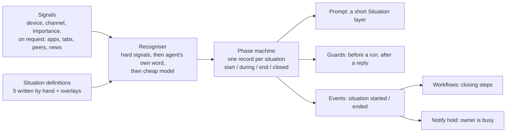

# Environment and situation awareness: design (#1892)

Status: **for review, nothing built.** This note is the written design asked for in #1892. Building starts after the architecture review and the owner's pick (see [Questions for the owner](#questions-for-the-owner)).

Checked on main (`a9314e5`, 0.226.5). All names below are made up: the agents `lead-agent` and `notes-agent`, the candidate, the machine `studio`. The fuller idea notes named in the issue (`secretary-workspace/ideas/…`) are not in this repository, so this note rests on the issue text and on the code.

## In one paragraph

Today an agent answers each message almost on its own: it knows the channel and the mesh, but not what is going on around the talk, and not where the talk is in its life. So two agents can keep thanking each other after a meeting is over, because nothing in AgentX knows the meeting is over. This design adds three small things. **Signals** are short facts about the environment (device, channel, importance, and others fetched only when asked). A **situation** is what is going on in one talk or around the owner (a conversation, a meeting, a lunch), with three phases: start, during, end. A small **phase machine** (plain code, no model) keeps one record per situation, tells the agent the phase and its rules in a few lines of the prompt, and stops replies that the phase forbids. Models are used only at the edges: a cheap one to recognise a situation or an ending when the code cannot tell, and a top one, rarely and offline, to draft a new kind of situation for a person to review.



## Where we are

| Wanted in #1892 | Exists today | Gap |
|---|---|---|
| Know the device | `NodeReport` (`src/node-env/index.ts`), `HostInfo` and `NativeAdapter` capabilities (`src/native/`), keyboard/mouse idle time (`NativeIdle`) | Not in the prompt as a short fact; no "what kind of device, is someone at it" line |
| Know the channel, both ways | Channel layer in `buildChannelLayer()` (`src/agents/context.ts:610`) with rules for telegram, whatsapp, gitlab, discord, webhooks. Where the owner can be reached: `PresenceStore` (`src/notify/reach.ts`) | `voice` and `app` have no rules. The reply side (where an answer will land and whether it will be seen) is not given to the agent |
| Know how important the talk is | `urgent` flag in `notify()`; task routing seats `task-tier`, `task-edge` | No importance value for a talk |
| Other signals on request | Frontmost app only (`helperFrontmostApp()`, `src/daemon/voice-presence.ts:57`); screen reading in `src/computer-use/` (helper is macOS only); peers through `A2AMesh.directory()`, the job ledger (`src/jobs/`), `agentx_agents`, `agentx_recent` | No open-apps list, no browser tabs, no news. No single way to ask |
| Owner is busy | Focus and call hold (`src/notify/focus.ts`, `hold.ts`), released by `attachFocusWatcher()` | System Focus is read on macOS only. "Busy" has two causes (Focus, call) and no room for others (lunch, meeting) |
| A talk has a life | Calls have states (`src/calls/store.ts`) but publish nothing on the event bus. Workflow runs have states | A chat has no start, no end. No `call:*` events |
| Agents do not loop | Counters only: chain depth 3 and "already in the chain" (`router.ts:1400`), `MAX_SEND_DEPTH = 4` (`src/a2a/delegation.ts:260`), `ChainBudget` (15 per agent per hour), workflow `loop-guard.ts`, own-echo drops (#522, `self-reply-guard`) | Every guard counts hops or spots an echo. None knows the talk is finished, so a loop runs until a counter stops it, and a real long talk can be cut by the same counter |
| Small model calls | `askSeat()` (`src/decisions/seat.ts:248`): typed question, cheap local backend, `off / shadow / active` per seat, every call recorded | Reused as is |
| Rules for a kind of work | Workflows (`src/workflows/`), triggered by hooks, cron, channel | Reused for closing steps |

Two names are already taken in the code, so this design avoids them: "signals" in `src/agents/signals/` (stop/resume a task) and `src/workflows/signals.ts`; "presence" in `src/voice/presence.ts`. The new module is `src/situations/`, and its facts are called **environment signals** in code (`EnvSignal`).

"Intent routing" in the issue maps to two pieces: the classifier in `src/graph/classifier.ts` (what the request is about) and the ledger in `src/intent/` (what was decided for each message). The situation is a third, separate answer: not "what is asked" but "what is going on". It is passed to both, and does not replace either.

## 1. Environment signals

A signal is one short fact with an age:

```ts
interface EnvSignal {
  key: string          // "device.kind", "talk.importance", "owner.hold", "apps.open"
  value: string | number | boolean | null   // null = this machine cannot tell
  at: number           // when it was read
  ttlMs: number        // after this it is stale and is not used
  scope: "node" | "owner" | "talk"
  source: string       // which provider
}
```

Each signal comes from a **provider**: a small function behind one interface, registered by key. The core knows only the interface. A provider that cannot answer on this machine returns `null`, as `NativeFocus.active()` already does; nothing in the core is tied to one operating system.

There are two classes, and the split is the main cost and privacy decision.

**Always there** (read by code, no model, a few lines in the prompt):

| Key | From | Notes |
|---|---|---|
| `device.kind`, `device.os`, `device.attended` | `HostInfo`, `NativeIdle.seconds()` | "server, nobody at it" versus "laptop, used 20 s ago" |
| `talk.channel.in`, `talk.channel.out` | the incoming message; `PresenceStore` | Both ways: where the words came from, and where an answer lands and whether the owner was seen there lately |
| `talk.with` | sender record | owner, known person, stranger, agent of this mesh, outside bot |
| `talk.importance` | rules first, see below | `low`, `normal`, `high`, `urgent` |
| `owner.hold` | `readHold()` | Focus, call, or an owner situation (section 5) |
| `time.local` | clock | working hours, night |

**Importance** is worked out by rules first: who is speaking (owner above stranger), a direct question or mention, the `urgent` flag, the channel (a call above a group chat), a deadline in the job ledger. Only when the rules disagree is a cheap seat asked (`talk-importance`). The value does two things: it is shown to the agent, and it lets a high or urgent talk pass an owner hold, as `urgent` does today.

**On request** (never read unless asked for; each one off by default):

| Key | From | Notes |
|---|---|---|
| `apps.open`, `apps.front` | computer-use helper | names only |
| `browser.tabs` | helper | titles and sites only |
| `browser.tab.content` | helper, then a cheap model to shorten | one tab, by the owner's or the agent's explicit ask |
| `peers.work` | job ledger, `agentx_agents`, event bus | what other agents are on, as bounded one-line summaries |
| `mesh.state` | `A2AMesh.directory()` | reachable nodes, their skills |
| `news.outside` | a configured feed or search tool | none ships by default |

They are reached through one tool, `agentx_environment` (ask for keys, get signals back), and can also be listed by a situation definition as "read these at start". Rules for this class:

1. Off until the owner turns a key on, per agent (`situations.signals.<key>.agents`).
2. Read on the node that owns the screen, and only a bounded summary leaves that node. Full tab content is never stored and never put on the event bus. This follows the same rule the repository keeps for cron responses: lists carry short summaries only.
3. A read is recorded (who asked, which key, when), so the owner can see what was looked at.

## 2. The situation model

A **situation** is what is going on, for one of two scopes:

- a **talk situation** belongs to one chat, thread or call: a conversation, a meeting, an interview, a hand-off between agents;
- an **owner situation** belongs to the person: lunch, a meeting they are in, a focus block, asleep. It changes how every agent of that owner behaves, mostly through the hold.

Each situation has four states. Three are the phases from the issue; the fourth is the fact that it is over.

| Phase | Meaning | Typical content |
|---|---|---|
| `start` | Opening | greet once, say who has which role, read the signals the definition asks for |
| `during` | The main part | the rules of this kind of talk |
| `end` | Closing has begun | one goodbye by one role, then the closing steps |
| `closed` | Over | nothing more is said; a new matter opens a new situation |

A **definition** says, per phase, the four things the issue lists: what to do, the rules, what is allowed or not, and the events that can happen. It is a YAML file in `.agentx/situations/`, next to workflows, and a definition can extend another:

```yaml
id: interview
extends: meeting
scope: talk
recognise:
  hint: "A job interview: one or more interviewers question a candidate."
  declaredBy: [workflow, agent]        # who may say "this is an interview"
roles: [lead, support, guest]          # guest = the candidate
phases:
  start:
    do: ["lead greets the guest once and gives the plan"]
  during:
    rules: ["one question at a time", "support takes notes and speaks only when lead asks"]
    deny: ["sharing other candidates' details"]
    events:
      guest-left: end                  # an event moves the phase
      guest-silent-5m: { ask: lead, text: "The guest is silent. Wait or close?" }
  end:
    say: { who: lead, times: 1 }       # one goodbye, by one role
    do: [{ workflow: interview-wrap-up }]
    deny: ["any further reply by support"]
    events:
      closing-done: closed
  closed:
    reopen: [person]                   # a person's message opens a new situation; an agent's does not
```

Three kinds of content, kept apart on purpose:

- `rules`, `do` as text, `allow`: go into the prompt. The agent's own model follows them. Soft.
- `deny`, `say.times`, `reopen`: checked by code before a run or after a reply. Hard.
- `do` with a `workflow:` and `events`: handled by the phase machine and the workflow engine. No new action engine is added; a closing step is a workflow started by the `situation:ended` event (a `trigger.hook`). Changes to those workflows follow the team's workflow-change rule, as any workflow change does.

An **instance** is one live situation: `{ id, kind, scope key (chat, thread or call), phase, roles by participant, started, last event, what was already said and done in this phase }`. It is one row in the node's database. The phase machine is the only writer.

## 3. How a situation is recognised and filled in

Listing every situation by hand cannot work, so the design never needs a full list. It rests on three choices.

### A few base kinds, written by hand

Five definitions ship, and every talk fits one of them:

| Base kind | Scope | Covers |
|---|---|---|
| `conversation` | talk | The default. Any chat. Has the start / during / end / closed life and nothing else |
| `meeting` | talk | Several participants at the same time, roles, an agenda, a clear end (interview, stand-up, sales call) |
| `hand-off` | talk | One agent gives work to another and waits (maps to a job in the ledger) |
| `owner-away` | owner | The owner must not be disturbed (lunch, focus, asleep, in a meeting) |
| `urgent` | talk | Something is broken or pressing: short answers, hold rules relaxed, the owner is reached |

Anything more exact (interview, lunch, stand-up) is an **overlay**: a small file that extends a base kind and adds or changes a few lines. When no overlay matches, the base kind's rules apply. So an unknown situation is never unhandled; it is handled a little more generally.

### Recognition is a ladder, cheapest step first

1. **Hard signals, no model.** A call starts or ends (`CallService`), talk mode starts or stops, a participant leaves a group, a workflow that declares `situation: interview` starts, an a2a request carries a situation, Focus turns on, a calendar entry begins (when a calendar provider is set up). Most starts and many ends are known this way.
2. **The agent says so.** The model doing the talking already understands the conversation; today it has nowhere to write that down. A small tool, `agentx_situation` (`start`, `event`, `end`), lets the agent state "this is an interview" or "the guest has left". The phase machine checks the claim against the definition (may this role declare it?) and records it. This costs nothing extra: it rides on a run that happens anyway.
3. **A cheap model at a boundary.** A seat, `situation-recognise`, is asked only when code sees a possible boundary and steps 1 and 2 said nothing: the first message of a new chat, a message after a long gap, a participant gone quiet past the definition's time, or several short turns in a row between agents. It gets the last few turns, the signals and the list of known kinds, and answers with typed fields: which kind, which phase, did an event happen. It is not called on every message.
4. **A counter as the last net.** In `conversation`, if agents alone exchange a set number of turns with no person speaking and no tool use, the situation moves to `end`. This is today's kind of guard, kept as the fallback rather than the only defence.

A wrong guess is cheap by design. Recognition changes soft things first (lines in the prompt). The only hard effect, not running an agent, needs all of: the situation is `closed` or the definition denies this role a reply, **and** the sender is an agent. A message from a person is never dropped by a situation; it reopens or starts one.

### New kinds are drafted once, then reviewed

When the recogniser keeps answering "none of the known overlays, closest base is `meeting`" for the same sort of talk, AgentX may ask a top-tier model, once and offline, to draft an overlay from the transcripts. The draft goes to `.agentx/situations/_drafts/`, as workflow drafts do, and stays unused until a person accepts it. This is the only place a top-tier model appears in the running system, and it is optional.

## 4. Where it sits in AgentX

One new module, `src/situations/`, and five touch points in what exists. Nothing is replaced.

| Step in a message's life | Existing place | What is added |
|---|---|---|
| Message arrives | `pre:channel-message` hook (`router.ts:822`), where workflows already claim messages (`src/workflows/hooks.ts`) | The phase machine finds or opens the instance for this chat, applies hard signals and events, and may return `blocked` (closed, agent sender). A block is written to the intent ledger as `halted` with reason `situation-closed`, so nothing is dropped silently |
| Prompt is built | `buildAgentContext()` (`src/agents/context.ts:213`) | One new layer, **Situation**, with its own small token budget: kind, phase, this agent's role, the rules of this phase, the always-there signals. It sits with the per-message layers, not in the landscape, so the cached part of the prompt is untouched. The channel layer also gains rules for `voice` and `app` |
| Agent runs | MCP tools (`src/mcp/index.ts`) | `agentx_situation` and `agentx_environment` |
| Reply is ready | `post:channel-message` hook (`router.ts:1239`) | Hard checks (`say.times`, `deny`), and marks what was said. Also applied where agents talk without that hook: the bot-to-bot chain (`handleBotToBotChain`) and a2a sends (`src/a2a/delegation.ts`) ask the phase machine before waking the next agent |
| Something changes | Event bus (`src/events/bus.ts`) | New events `situation:started`, `situation:phase`, `situation:ended`, and the missing `call:started`, `call:ended`. Workflows subscribe for closing steps; other agents can subscribe as they do for any event |

**Across the mesh.** A talk between agents on two nodes must end on both. The situation id and phase travel with the a2a message as a small header, and phase changes go out on the event bus, which already reaches peers (`peer-feed.ts`). The node that opened the situation owns its record; the other keeps a copy. The instance id is derived from the event envelope's `rootId`, which helps with a known gap (mesh hops have no shared root activity id) without waiting for it to be closed.

**Dashboard.** One compact list of open situations per node (kind, phase, who, how long), with rules and history behind a disclosure, built with the existing server-rendered pages. Not part of the first steps.

## 5. The owner's situations and the hold

Focus and call hold are already an owner situation in all but name: "the owner is busy, keep non-urgent messages". This design keeps `focus.json`, `call.json` and the macOS Focus reader exactly as they are and treats them as providers of `owner.hold`. An `owner-away` situation (lunch from the calendar, a meeting, a manual "I'm out for an hour") becomes one more provider. `readHold()` gains that third source and nothing else changes for `notify()`, the queue or the watcher.

Phases give the hold what it lacks today:

- `start`: say once, where it helps, that the owner is away and until when;
- `during`: hold, except what `talk.importance` marks high or urgent;
- `end`: flush as one digest (already done by `flushHeld()`), and optionally one short "while you were out" summary.

On a machine with no Focus reader (Linux, Windows, a server), the manual and calendar providers still work, which makes the hold usable off the Mac for the first time.

## 6. Model tier per part

"Tier" here means model size and price, not the agent's `tier` setting in the config (that one is the engine). The design itself was written on a Fable model, as asked. The running system needs the following.

| Part | Tier | How often | Why |
|---|---|---|---|
| Reading always-there signals | No model | Every message | File reads and lookups |
| Phase machine, hard guards, counter | No model | Every message | A state table |
| Importance | No model; cheap seat on a tie | Rarely | Rules settle most cases |
| Recognising a kind, a phase change, an event | Cheap (the seats' default local backend, a Haiku-class model) | Only at a boundary: about one to three calls per talk, none in a talk whose start and end are hard signals | A typed, short question over a few turns. The same shape as the existing seats |
| Shortening a tab or a peer's work | Cheap | Only when that signal is asked for | Summarising, no judgement |
| The talk itself | Whatever the agent already runs on | Every run, as today | Unchanged. It gets about 100 to 150 more tokens (the Situation layer) |
| Drafting a new overlay | Top (Fable-class) | Once per new kind, offline, optional | Needs judgement over many transcripts; a person reviews the result |
| Writing the five base kinds | By hand | Once | Small, and they set behaviour for everything else |

Cost reasoning, in order of weight:

1. **No model call is added per message.** The per-message additions are code and a short prompt layer. This is the constraint in the issue, and the reason the phase machine is plain code rather than a model that "watches" the talk.
2. **The cheap calls are few and small.** A boundary check reads a few recent turns and returns a handful of typed fields. Because the first two steps of the ladder cost nothing, the seat only runs when they are silent.
3. **The design should save more than it spends.** Each round of a goodbye loop is a full agent run on the agent's own model on each side, and on a public channel also a posted comment (#522 counted 17 in four minutes). One cheap call, or none, replaces that.
4. **The seat modes give a safe rollout.** `shadow` records what the seat would have answered without acting on it, so quality and cost are measured on real traffic before anything is enforced.

These are estimates of shape, not measured figures. The first build step records the counts needed to replace them with numbers.

## 7. The interview, walked through

Setting: a text interview in one group chat. `lead-agent` asks the questions, `notes-agent` takes notes, and the candidate is a person. The same steps hold if the candidate is an agent, or if only two agents talk.

**Today.** The candidate writes "Thanks, bye" and leaves. `lead-agent` answers "Thank you, goodbye" and names `notes-agent`. That mention wakes `notes-agent`, which thanks `lead-agent` back, and so on over a2a or the chat until a depth limit or the hourly chain budget stops it. Each round is a full run. Nobody writes the notes up, because nothing told anyone the interview had ended.

**With this design.**

1. **Start.** The workflow that set up the interview declares `situation: interview` with the roles (ladder step 1). Without such a workflow, `lead-agent` declares it with `agentx_situation start`, or the seat recognises it on the first message. The instance is opened: phase `start`, roles `lead`, `support`, `guest`.
2. **During.** Both agents see a few lines in their prompt: "Situation: interview, during. Your role: support. Take notes; speak only when lead asks." `lead-agent` greeted once, so the phase moved to `during`. No model call beyond the agents' own runs.
3. **The candidate leaves.** One of three things records the event `guest-left`: the channel reports that the participant left (hard signal); `lead-agent`, reading "Thanks, bye", calls `agentx_situation event guest-left`; or neither happens and the next boundary check (short turns between agents only) asks the seat, which answers "event: guest-left". The definition says `guest-left: end`.
4. **End.** The phase machine publishes `situation:phase` (end). `lead-agent`'s prompt for its current or next turn says: "Situation: interview, end. Say one goodbye. Then nothing more." It says it. The phase machine notes that the goodbye was said (`say.times: 1` is used up).
5. **The loop that does not happen.** `lead-agent`'s goodbye reaches `notes-agent`. Before any run, the phase machine sees: phase `end`, role `support`, replies denied. `notes-agent` is not woken; the ledger records `halted, situation-closed`. Even if `lead-agent` were to produce a second goodbye, the check after the reply stops it from being sent.
6. **Closing steps.** `situation:ended` starts the `interview-wrap-up` workflow: `notes-agent` writes the notes up, the scores are saved, the owner gets one message (held if the owner is away). When the workflow finishes it reports `closing-done` and the instance is `closed`.
7. **After.** If the candidate writes again an hour later, a person's message opens a new `conversation`. If an agent writes into the closed chat, it is recorded and not run.

If every recognition step failed (no hard signal, the agent did not declare, the seat is off), the counter in the base `conversation` kind still moves the talk to `end` after a few agent-only turns. That is no worse than today's limits, and it ends with the closing steps instead of a cut.

## 8. Build plan

Each phase ships alone and is useful alone. Everything new starts in `shadow` (record, do not act), as seats and the intent ledger do.

| Phase | What | Model use |
|---|---|---|
| **1. A talk can end** (first buildable step) | `src/situations/` with the instance store and the phase machine; the base `conversation` kind in code; the check before a run on the three agent-to-agent paths (channel hook, bot-to-bot chain, a2a send); the agent-only turn counter; `halted` rows in the ledger; a `situations.mode` setting (`off`, `shadow`, `active`). Test: a recorded goodbye loop is replayed and ends after one goodbye | None |
| 2. The agent knows | The Situation layer in the prompt; always-there signals and the provider interface; `voice` and `app` channel rules; `agentx_situation` tool; `situation:*` and `call:*` events | None |
| 3. Recognition | YAML definitions with `extends`; the five base kinds and two or three overlays (`interview` first); seats `situation-recognise` and `talk-importance`, in shadow first | Cheap, at boundaries |
| 4. Owner situations | `owner-away` as a third hold source; manual and calendar providers; closing steps as workflows | None |
| 5. Signals on request | `agentx_environment`; apps, tabs, tab content, peers, mesh; per-agent switches and the read record; providers for other operating systems as helpers allow | Cheap, when asked |
| 6. Mesh and learning | Situation header on a2a messages and phase events across nodes; the dashboard list; drafted overlays in `_drafts` | Top tier, optional and offline |

**First step, named:** phase 1, in `shadow`. It needs no model, no new file format and no prompt change, and it is the part that fixes the example in the issue. Running it in shadow for a week also yields the numbers this note estimates: how many talks, how many agent-only turns, how many runs it would have saved.

Each phase that adds a setting, a tool or a command also adds its page under `docs/` in the same pull request, as the repository's documentation rule asks.

## Alternatives considered

- **Let the model handle it with a longer prompt** ("know when a conversation is over"). No new code, but it is what happens today: each agent decides alone on each message, and a polite model answers a goodbye with a goodbye. There is no shared record that the talk ended, and nothing to enforce it.
- **A model that watches every message and reports the situation.** Simple to reason about, but it adds a model call per message, which the issue rules out, and it makes every reply wait for it.
- **Only raise or tune the counters.** Cheap, but a counter cannot tell a loop from a long, real exchange, and it ends a talk without the closing steps.
- **Model situations as workflows.** Workflows are steps toward an outcome; a situation is a state that many unrelated messages pass through, often with no workflow running. Forcing one into the other would need a workflow run per chat. Using workflows only for the closing steps keeps each tool for what it is good at.

## Risks

- **A talk is closed too early.** Kept small by: soft effects first, never dropping a person's message, reopening on a person's word, and shadow mode before enforcing.
- **Private screen content leaks.** On-request signals are off by default, per agent, summarised on the owning node, never stored in full, and every read is recorded.
- **Two nodes disagree on the phase.** One node owns the record; the other follows events. If events are lost, the follower falls back to its own counter.
- **Definitions pile up or contradict each other.** Five base kinds only, overlays must extend one, drafts need a person's yes.
- **Prompt cache.** The Situation layer changes with the phase, so it is placed with the per-message layers and kept out of the cached landscape.

## Questions for the owner

1. **First step.** Start with phase 1 (a talk can end, no model) as recommended, or with phase 2 (the agent sees its situation) because it is more visible?
2. **Hard stop or soft only.** May a situation stop an agent's reply by code (recommended, for agent senders only), or should it only advise through the prompt?
3. **Screen signals.** Are open apps and browser tabs wanted in the first release, or after the talk and owner parts work (recommended: after, phase 5)?
4. **Drafted overlays.** Should AgentX propose new kinds by itself with a top-tier model (phase 6), or should overlays stay hand-written?
5. **Base kinds.** Are the five (`conversation`, `meeting`, `hand-off`, `owner-away`, `urgent`) the right set?

## Check it worked (for this design)

- Each checklist line in #1892 has a section here: signals (1), the situation model (2), recognition (3), where it sits (4), model tiers with cost reasoning (6), the interview (7), the build plan with the first step named (8).
- The file and function names in "Where we are" exist on main at `a9314e5`.
- Still open, and not something this note can do: the architecture review, and the owner's pick.

## If something is wrong

- If a piece named here has moved or changed, comment on #1892 with the path; the table in "Where we are" is the part most likely to age.
- If the review finds a talk this model cannot hold (for example one chat with two situations at once), say which, and the instance key in section 2 is the place to change.
- If the answer to question 2 is "soft only", sections 4 and 7 lose the checks before a run and after a reply, and step 5 of the walk-through relies on the prompt alone; the design then needs the counter to stay as the hard stop.
