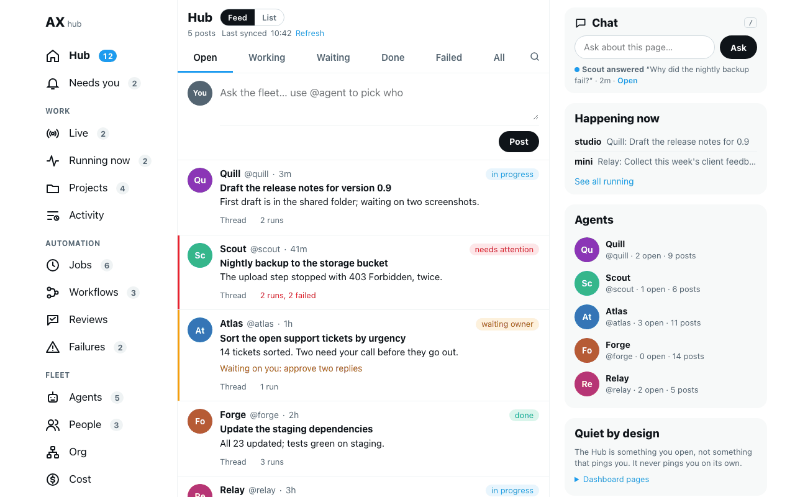
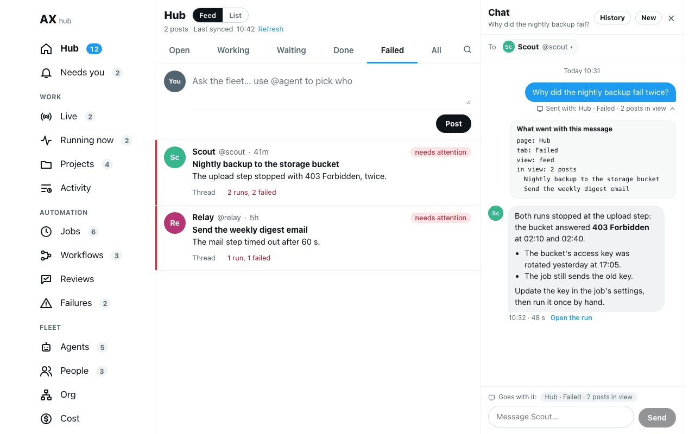
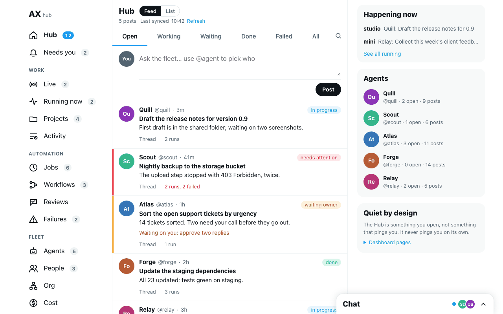
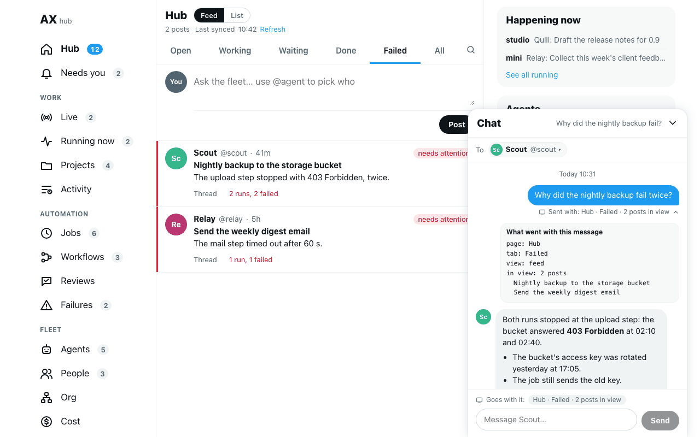
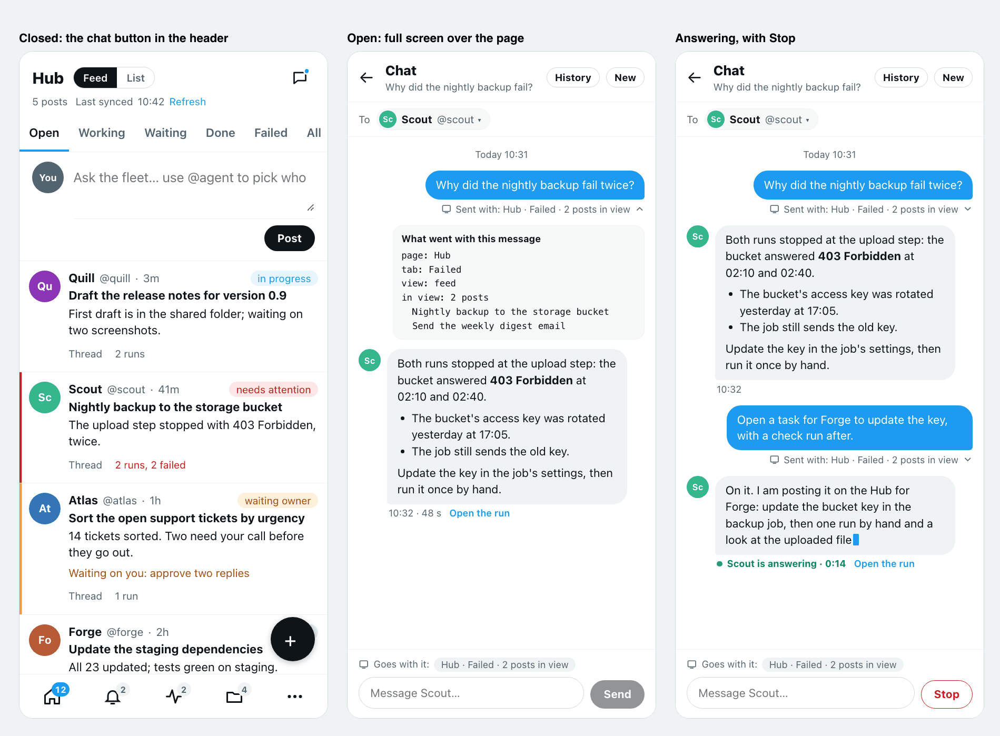
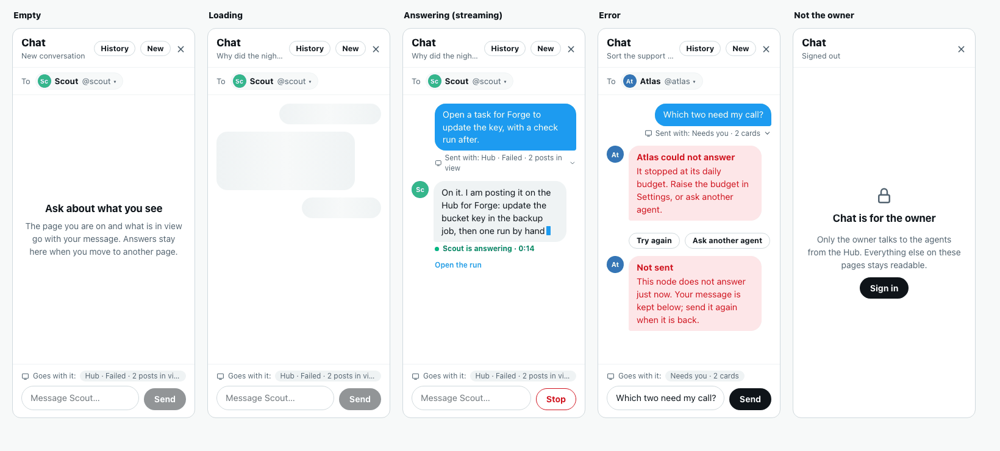

# Hub chat panel, round 1 (#1528, epic #1449)

Design proposal for review. Nothing here is built. Per #1528, the chat panel goes through the same gate as the #1451 pages: it is built only after the owner accepts a layout.

Every screen is in this note as an image (under `img/hub-chat-panel/`), so it opens on GitHub without any other tool. Comment here or on #1528.

All data on the screens is made up: agents (Forge, Quill, Scout, Atlas, Relay), machines (studio, mini), posts and answers. The screens are the real Hub page (`renderWallPage()` from `main`, its CSS and tokens from `wall-space.ts`) with static demo data in place of the API, plus the panel drawn on top. They were rendered with headless Chrome: desktop at 1280 × 800, the phone as 390 px frames.

## The screens

| # | Screen | What it proposes |
|---|---|---|
| 1 | Option A, closed (desktop) | A **Chat** box at the top of the side column: one line to ask, and the last conversation with a dot when an answer waits. |
| 2 | Option A, open (desktop) | The side column becomes the chat, full height. The page stays fully visible. The page context shows under the message. |
| 3 | Option B, closed (desktop) | A **Chat** bar docked at the bottom right, as X's Messages: a dot and the last agents. |
| 4 | Option B, open (desktop) | The dock grows to 600 px tall over the side column. |
| 5 | Phone, 390 px | Closed: a chat button in the Hub's header. Open: full screen. Answering, with Stop. Same for A and B. |
| 6 | States | Empty, loading, answering (streaming), error, not the owner. |

## 1 and 2. Option A: the side column becomes the chat (recommended)

- **Closed**: a **Chat** box is the first box of the side column, above Happening now. Typing there and pressing **Ask** sends the question and opens the panel, as the classic bar does. `/` puts the cursor in it when no other field has focus. Under the box, the last conversation: "Scout answered … · 2m · Open", with a blue dot while an answer has not been opened.
- **Open**: the side column (350 px) shows the chat instead of its boxes, full height and sticky, so the feed, the nav and the open post stay where they are. This keeps the classic drawer's rule that the chat must not cover the rows you ask about; here no page reflow is needed because the Hub already has that column.
- **Inside the panel**, top to bottom: the title (the conversation's first question), **History**, **New**, close; **To**, the agent picker (the node picker shows only when there is more than one node to pick; the classic drawer shows "This node" alone); the thread; the composer with the context line.
- **Between 640 and 1180 px** the Hub has no side column (`wall-space.ts`): the panel opens over the right part of the page, 380 px wide, and the chat button sits in the header as on the phone.

## 3 and 4. Option B: a dock at the bottom right

- **Closed**: a 400 px bar at the bottom right, on every page: **Chat**, a dot when an answer waits, the faces of the last agents asked.
- **Open**: it grows to 600 px tall, over the bottom of the side column. Same content as A.
- **For**: always in the same place, whatever the page draws in its side column; closest to the X look the Hub follows.
- **Against**: it covers part of the side column (Agents, the Decisions and Workflows side panels) and, on short screens, the bottom of the feed. The thread is shorter than in A.

## 5. Phone, 390 px (both options)

- **Closed**: a chat button on the right of the Hub's sticky header, with a blue dot while an answer is not opened. The bottom bar keeps its five buttons and New post keeps its round +.
- **Open**: full screen over the page, with ← back to it. The composer sits at the bottom, above the keyboard.
- **Answering**: the reply grows as the agent writes, "Scout is answering · 0:14", **Stop** in place of Send, and **Open the run**.

## 6. States

- **Empty**: "Ask about what you see. The page you are on and what is in view go with your message. Answers stay here when you move to another page."
- **Loading**: three placeholder bubbles while the conversation loads, only after half a second.
- **Answering (streaming)**: see the phone above.
- **Error**: the agent's own failure shows as its reply in red ("Atlas could not answer: it stopped at its daily budget …") with **Try again** and **Ask another agent**. When the node does not answer, the message is not lost: "Not sent", and its text stays in the composer.
- **Not the owner**: no history, no composer. "Chat is for the owner … Everything else on these pages stays readable", with **Sign in**. (Question 2: or no chat button at all.)

## The page context with a message

Each message carries what the page shows, as `window.axPageContext` does on classic pages. Under the composer, "Goes with it: Hub · Failed · 2 posts in view". Under each sent message, "Sent with: …"; a tap opens **What went with this message** with the exact fields (screen 2).

The Hub sets no `axPageContext` today. The build adds one function in the Hub's script that reads its own state: the page (`#page=…` or the view), the status tab, the filters that are set, the open post or run (id and title), and the titles of the rows in view, capped. Each later Hub page then gets it without any work of its own; a page can add fields, as classic pages do.

## What it reuses

**One back end: the classic drawer's.** The panel calls the same routes as `src/daemon/ui/assistant.ts`:

| Need | Route (unchanged) |
|---|---|
| Send a message, new or next turn | `POST /api/assistant` `{threadId?, agentId, node?, message, context}` |
| Read a conversation | `GET /api/assistant/thread?id=` |
| History | `GET /api/assistant/threads` |
| Delete one | `POST /api/assistant/delete` |
| Agents and nodes for the pickers | `GET /api/agents`, `GET /api/monitor` |

- **Same conversation as the classic drawer.** The panel remembers its conversation in the same `localStorage` key (`ax-assistant-thread`), so a question asked on a classic page continues on the Hub and back. The turn runs on the daemon, so leaving the page loses nothing.
- **Moving between Hub pages** keeps the panel as it is: the Hub is one document with `#page=` links, so the panel is mounted once in `renderWallPage()` next to the nav and is never redrawn by a page change.
- **Answering**: the classic drawer shows "Thinking…" and reads the conversation again every 1.5 s until the answer is in. The panel does the same, so it works with no daemon change. For the reply to grow as the agent writes (screen 5), the panel needs the id of the run behind the pending turn, to open the existing `/api/task/stream`. The daemon knows it as soon as the run starts (the running task's id, the one Live lists and `subscribeToTaskOutput()` takes), but `POST /api/assistant` runs the turn in the background and keeps no link to it. The build keeps that id on the pending message and returns it in `GET /api/assistant/thread`. That is a field on the existing store (`assistant-store.ts`), not a second chat back end. **Stop** then uses the existing `POST /api/task/action kind=cancel`.
- **Owner-only on the server.** The guard comes from #1608, not from this build: it puts every `/api/assistant` route on the dashboard behind the dashboard's owner rule (`isDashboardOwner`). The reads are guarded too, because the conversations are the owner's. The build starts after #1608 merges and adds no guard of its own. The panel is drawn only when `renderWallPage()` gets `owner`, as Settings is today.

## Can the Task page steer chat (#1381) share the thread view?

In part. The two are different things on the daemon:

| | Hub chat | Task page steer box |
|---|---|---|
| What it shows | a conversation: question and answer bubbles (`assistant-store`) | one run: its full transcript with tool calls (`/api/task/stream`, `/api/task/history`) |
| What sending does | a new turn in the conversation | a message queued into the running turn's session (`/api/task/action kind=followup`) |

So the proposal shares the parts that are the same, and keeps two composers:

1. **The live reply.** While a chat turn runs, the panel reads the run's `/api/task/stream`, the reader `mountTaskPage()` already has in `wall-task.client.ts`. The build lifts that reader into a small shared function that both use.
2. **One markdown renderer.** The Task page has its own `mdToHtml`, the classic drawer uses `markdownToHtml` (`src/utils/markdown-html.ts`). The panel uses `markdownToHtml`, and the Task page can move to it in the same build.
3. **A link each way.** **Open the run** under a reply opens that run's Task page (`#page=task&task=…`). The Task page keeps its steer box, because steering a run and asking a question are different actions.

Drawing the full run transcript inside the panel is not proposed: tool calls make it too long for a side column, and the Task page already shows it.

## Questions for the owner

1. **Layout**: A, the side column becomes the chat (recommended, screens 1 and 2), or B, a dock at the bottom right (screens 3 and 4)? The phone is the same for both.
2. **Not the owner**: show the chat button with "Chat is for the owner · Sign in" (drawn), or no chat at all?
3. **Chat and New post**: the Hub's composer gives an agent a task that shows as a post; the chat asks a question and leaves no post. Keep both as drawn, or should a chat answer offer **Post as a task**?

## Next step

Once a layout is accepted, the build goes on #1528: the panel in `renderWallPage()`, the Hub's `axPageContext`, the run id on pending turns, the Wall page check (`scripts/wall-page-check.json`) at 390 px and desktop, and the Hub docs page with new screenshots. The owner guard on `/api/assistant` is #1608 and must be merged first.
