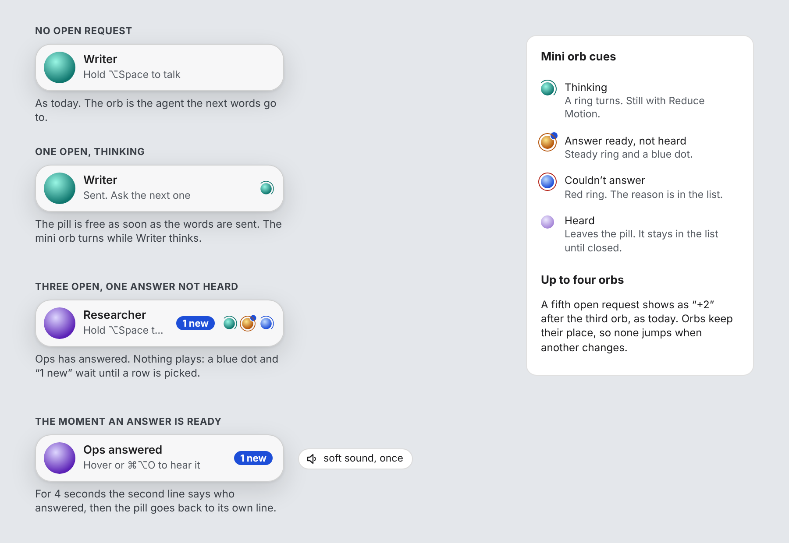
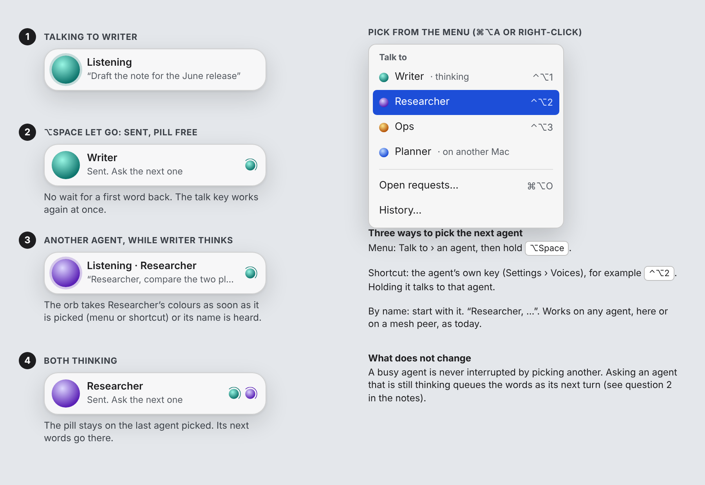
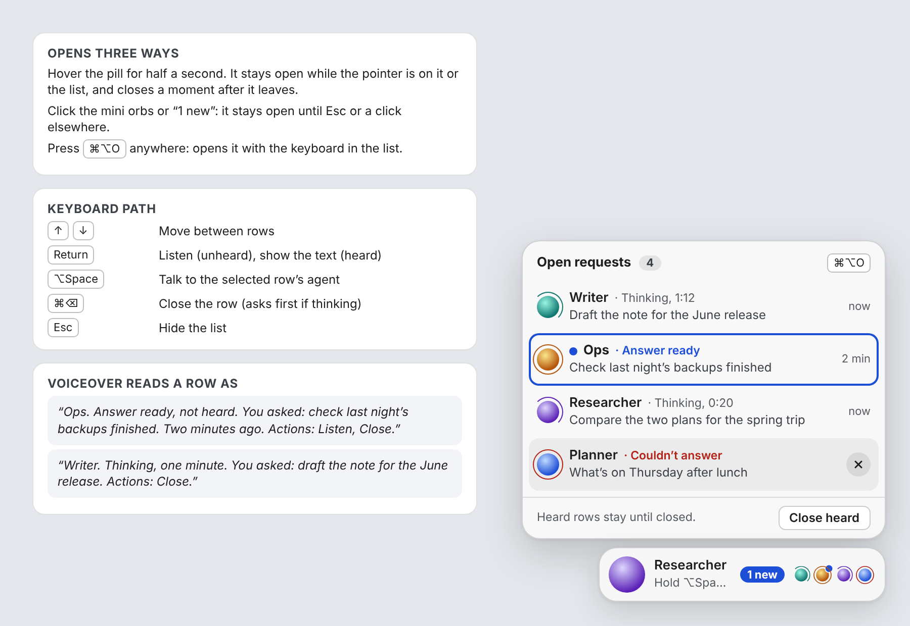
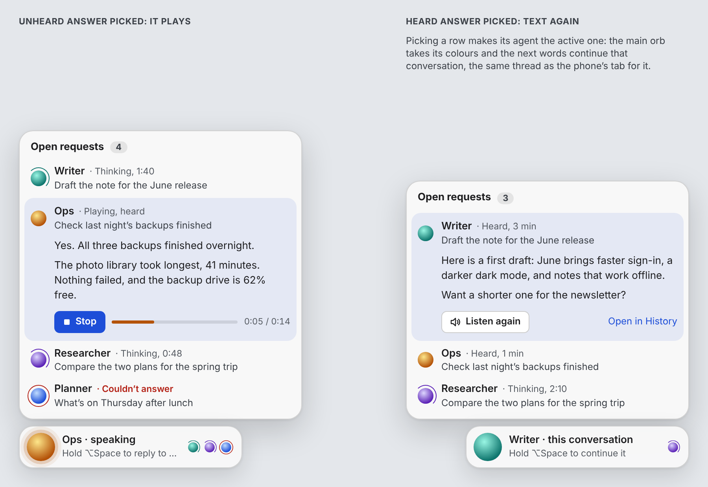
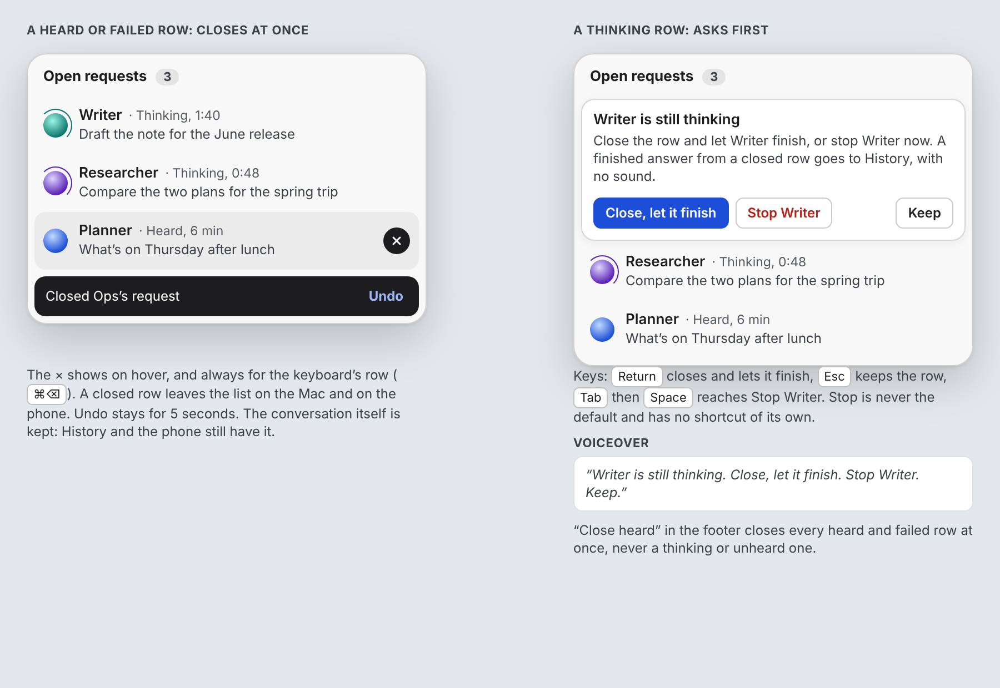
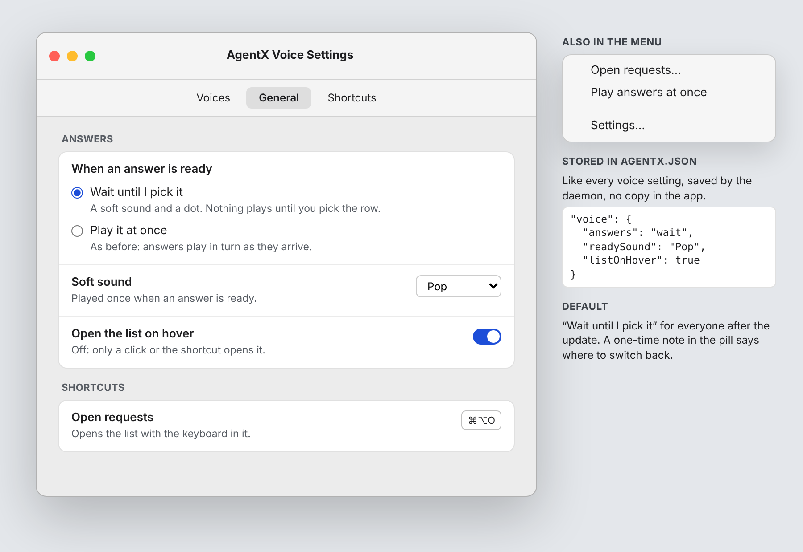
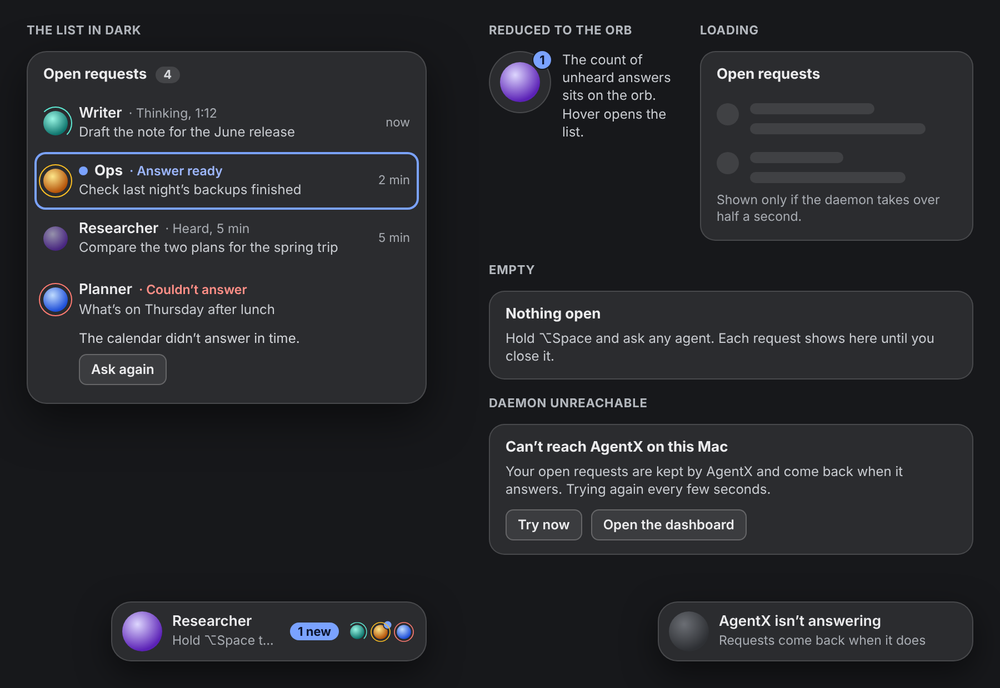
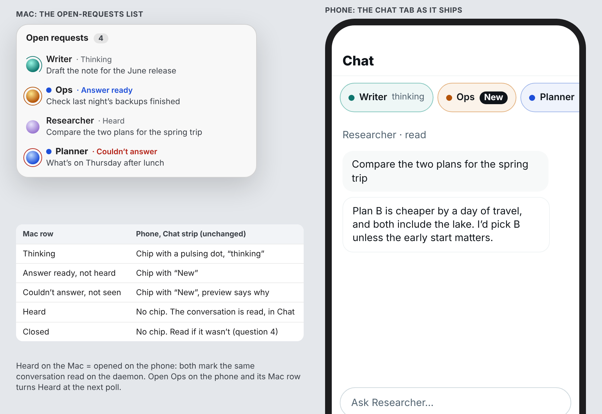

# AgentX Voice: parallel requests, round 1 (#1460 for #1455)

Design accepted on 2026-10-27 (see [Verdict](#verdict)). Nothing here is built yet. Per #1455 and #1460, the widget change is built only after the owner accepts its design.

Each screen is shown below as an image (`img/voice-parallel-requests/`), so the note reads on GitHub without the canvas. The same screens are on the design canvas for those with access: https://claude.ai/artifact/J1pQGfbNzc2rmL59kveutz (comment on any screen there, or on #1460).

All data on the screens is made up. The look is the pill as it ships: 284 × 54 pt, 18 pt corners, popover blur with a light wash (`Surface.swift`), the system font, the agents' orb colours, and the mini orbs from `MiniOrbs.swift`. Screens are at real size on a plain desktop. The images are exported from the canvas at 2×; their text is set in Inter, a close stand-in for the system font, so a few long lines cut off a little earlier than they would on a Mac.

## The screens

| # | Screen | What it proposes |
|---|---|---|
| 1 | Pill, idle and busy | 0, 1 and 3 open requests; the "not heard" cue: a blue dot, "1 new" and one soft sound, no auto-play. |
| 2 | Send and move on | The pill is free once the words are sent. Picking another agent by menu, shortcut or name while the first thinks. |
| 3 | Open-requests list | Opens on hover, click or ⌘⌥O. One row per request with its state. Keyboard path and VoiceOver text. |
| 4 | Picked row | An unheard answer plays with its text; a heard one shows its text and **Listen again**. The picked agent becomes the active one. |
| 5 | Close | A heard or failed row closes at once, with Undo. A thinking row asks first; stopping the agent is never the default. |
| 6 | Setting | "When an answer is ready": wait until I pick it (new default) or play it at once (as before). |
| 7 | Dark, empty, loading, error | The list in dark, the pill reduced to its orb with a count, loading, empty, daemon unreachable, a failed request. |
| 8 | Same requests on the phone | The Mac list beside the phone's Chat strip as it ships, and how each state maps. |

## 1. Pill, idle and busy

- **No open request**: as today.
- **One open, thinking**: the second line says "Sent. Ask the next one" and one mini orb turns. Today's rule for when the row of mini orbs shows (`PillBusy.showsRow`) stays.
- **Three open, one not heard**: the mini orb of the agent that answered gets a steady ring and a blue dot, and a "1 new" capsule sits before the orbs. Nothing plays.
- **The moment an answer is ready**: one soft sound, and for about four seconds the second line says who answered and how to hear it. Then the pill goes back to its own line.
- Mini orb cues: thinking (a turning ring), ready and not heard (steady ring and dot), couldn't answer (red ring). A heard request leaves the pill row but stays in the list. Up to four orbs, then "+n", and orbs keep their place, as today.

Change from today: the `answering` cue ("answer waiting to be spoken") becomes "ready, not heard". With auto-play off, nothing waits in the speaking queue until a row is picked.

## 2. Send and move on

Four steps on one pill: talking to Writer; ⌥Space let go, so the request is sent and the pill is free; picking Researcher while Writer thinks; both thinking.

The next agent can be picked three ways, all of which exist today:
- the menu (⌘⌥A or right-click) › **Talk to**, which now shows each agent's state and shortcut;
- the agent's own shortcut (`agents[].voice.hotkey`, set in Settings › Voices);
- its name at the start ("Researcher, …"), here or on a mesh peer.

The main orb takes the picked agent's colours at once, and stays on the last agent picked.

## 3. Open-requests list

- **Opens** on a half-second hover over the pill (it stays while the pointer is on the pill or the list), on a click on the mini orbs or "1 new" (stays until Esc or a click elsewhere), or with **⌘⌥O** from anywhere (the keyboard lands in the list).
- It grows up or down from the pill, whichever has more room, 360 pt wide: the same rule and width as the answer view today (`PillPlacement.swift`, `Panel.expandedWidth`).
- **One row per request**: the agent's mini orb, its name, the state (thinking with a timer, answer ready, heard, couldn't answer), the first words of the request, and how long ago. An unheard row has a blue dot and a bold name. The × shows on hover and on the keyboard's row.
- **Order**: by when each was sent, newest at the bottom next to the pill. Rows never jump when a state changes (question 3).
- **Footer**: "Close heard" closes every heard and failed row.
- **Keyboard**: ↑ ↓ move, Return listens (unheard) or shows the text (heard), ⌥Space talks to the selected row's agent, ⌘⌫ closes, Esc hides.
- **VoiceOver** reads a row as: "Ops. Answer ready, not heard. You asked: check last night's backups finished. Two minutes ago. Actions: Listen, Close."

## 4. Picked row

- **Unheard row**: it opens in place, its answer plays in the agent's voice, and its text shows with **Stop** and the play progress. The row is marked heard as soon as it starts playing (question 5).
- **Heard row**: its text shows with **Listen again** (the button from #492, `ListenAgain.swift`) and **Open in History**.
- **The picked agent is the active one**: the main orb takes its colours and the pill says "Hold ⌥Space to continue it". The next words continue that conversation, in the same thread as the phone's conversation with that agent.

## 5. Close

- **Heard or failed row**: closes at once. "Closed Ops's request · Undo" stays for five seconds. The conversation itself is kept in History and on the phone; only the row goes.
- **Thinking row**: the row turns into a confirm: "Writer is still thinking". **Close, let it finish** (default, Return), **Stop Writer** (Tab, then Space: never the default, no shortcut of its own), **Keep** (Esc). A finished answer from a closed row goes to History with no sound.
- **Unheard row**: closes at once, like a heard one (question 4 asks whether that also marks it read on the phone).

## 6. Setting

In Settings › General, a new **Answers** group:
- **When an answer is ready**: "Wait until I pick it" (soft sound and a dot) or "Play it at once" (as before).
- **Soft sound**: which system sound plays once.
- **Open the list on hover**: off means only a click or ⌘⌥O opens it.
- **Open requests** shortcut under Shortcuts, ⌘⌥O by default.

The menu gets **Open requests…** and a tick for **Play answers at once**. Like every voice setting today, these are saved by the daemon in `agentx.json` through `POST /voice/settings` (proposed keys: `voice.answers` `"wait"` or `"play"`, `voice.readySound`, `voice.listOnHover`), with no copy in the app.

## 7. Dark, empty, loading, error

- **Dark**: the same list on the dark popover, with lighter blue and red for contrast.
- **Reduced to the orb** (#457): the count of unheard answers sits on the orb; hover opens the list.
- **Loading**: two placeholder rows, only if the daemon takes more than half a second.
- **Empty**: "Nothing open. Hold ⌥Space and ask any agent."
- **Daemon unreachable**: the list says the requests are kept by AgentX and come back when it answers, with **Try now** and **Open the dashboard**. The pill's orb turns grey.
- **A request that failed**: red ring, "Couldn't answer", the reason in one line when the row is picked, and **Ask again**.

## 8. Same requests on the phone

No phone change. The phone's Chat strip (`app-chat-strip.client.ts`) already shows one chip per conversation that is running or has an answer not opened yet. The mapping:

| Mac row | Phone Chat strip |
|---|---|
| Thinking | chip with a pulsing dot, "thinking" |
| Answer ready, not heard | chip with "New" |
| Couldn't answer, not seen | chip with "New", its preview says why |
| Heard | no chip; the conversation is read |
| Closed | no chip; read if it wasn't (question 4) |

"Heard" on the Mac and "opened" on the phone are the same thing: both mark the conversation read on the daemon. Open Ops on the phone and its Mac row turns Heard at the next poll, and the other way round.

## What it rests on (checked in main)

- **The Mac has no daemon-side conversation today.** It sends `POST /ask` with one session id made at launch (`Config.voiceSession`, a new UUID each time). Quitting the app loses the thread, and nothing on the daemon knows which requests are open. The acceptance criterion "a daemon restart keeps the list" needs the list kept by the daemon.
- **The phone's conversations are per device.** `app_chat_conversations` has a `device_id` and a `read_at` per conversation (`app-chat-store.ts`), and `GET /api/app/chat/active` returns one device's running turns and unread answers. The proposal is that the Mac's requests become conversations in that same store, so the strip, History and heard state are one source (question 1).
- **Answers play by themselves today.** The daemon puts every finished answer on its one speaking queue (`speaking-queue.ts`). In "wait" mode the answer is kept unheard instead, and picking the row puts it on the queue then, as Listen again does today.
- **One question per agent today** (README, Known limits). The list keeps that rule per conversation: a second request to an agent that is still thinking waits as its next turn (question 2).

## Questions for the owner

1. **One conversation for both, or one per device?** For Mac and phone to agree, the Mac's request to Ops and the phone's tab for Ops must be the same conversation. Should "heard" be per owner (opened on any device = heard everywhere), as drawn, or kept per device as the phone does today?
2. **A second request to a busy agent**: queue it as that conversation's next turn (drawn), or start a second row for the same agent?
3. **Order of the rows**: by when each was sent, newest next to the pill (drawn, rows never move), or unheard answers first?
4. **Closing an unheard row**: should it also mark it read on the phone (drawn), or only hide it on the Mac?
5. **When is an answer heard**: as soon as it starts playing (drawn), or only when it plays to the end or its text is opened?
6. **Default after the update**: "Wait until I pick it" for everyone (drawn), or keep auto-play for existing installs and make waiting the default only for new ones?
7. **The list shortcut**: ⌘⌥O is free in the app today. Is that the key you want?

## Verdict

Accepted. The owner approved all eight round 1 screens on 2026-10-27 (by voice, through Hakim, recorded on #1460). There is no round 2.

- **Screens**: 1 to 8 accepted as drawn.
- **Questions 1 to 7**: no separate answer was given, so the build starts from the option marked "drawn" for each. Anything the owner changes on #1455 wins over this note.

## Next step

The build goes on #1455: `apps/mac-voice` with the daemon changes above, with the README's Known limits and the AgentX Voice guide updated in the same PR.
