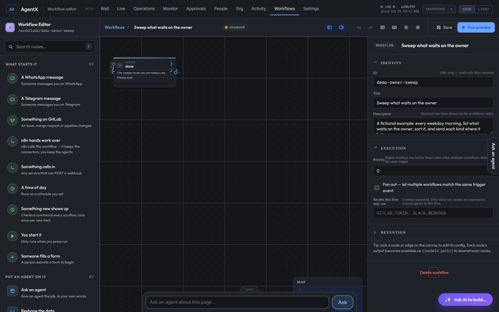
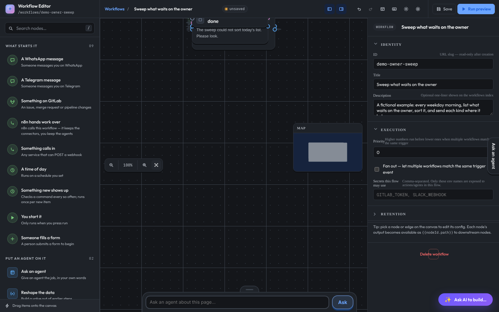
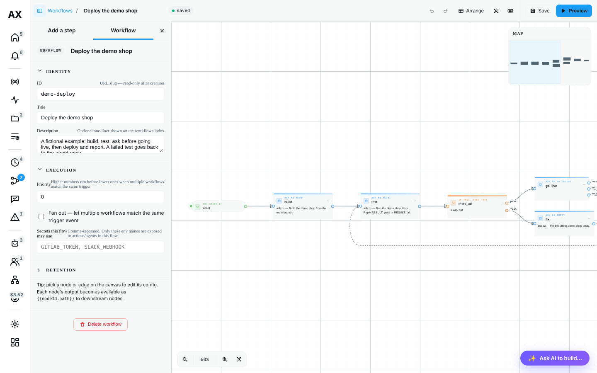
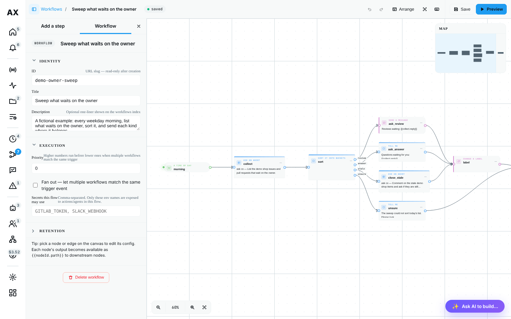
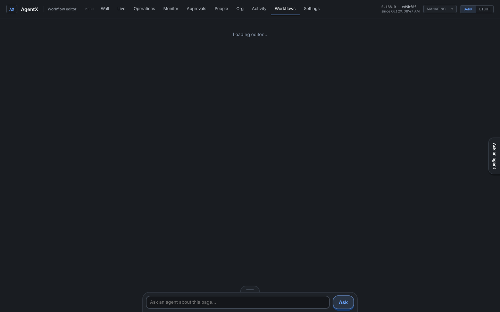
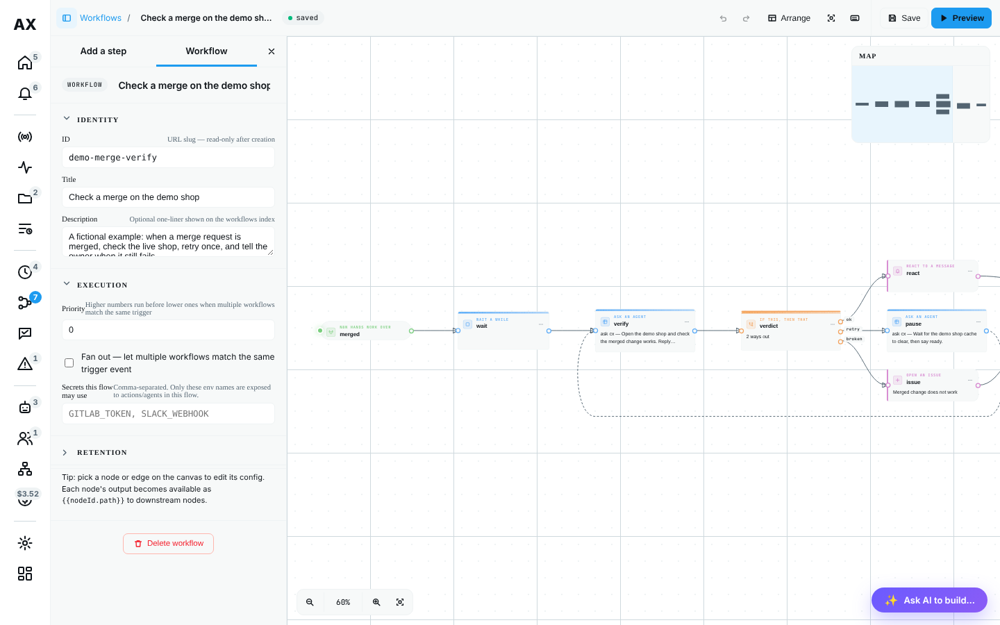
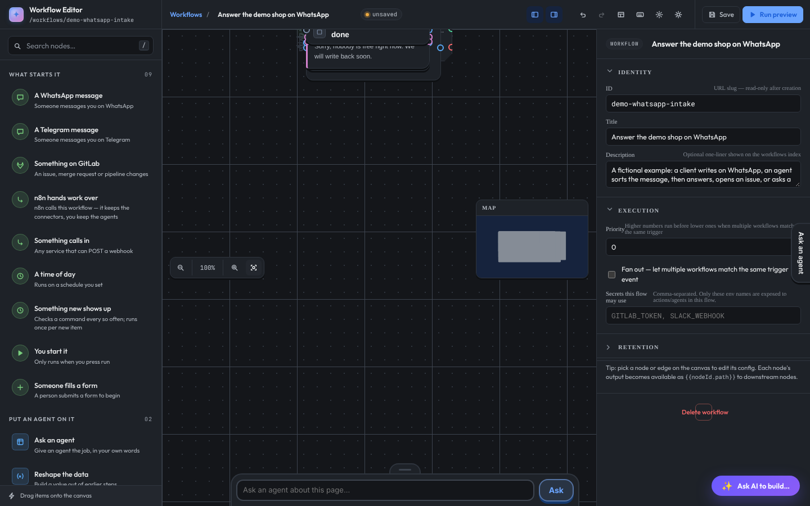

# The workflow editor on the Wall (#1524)

Owner decision on #1449, 2026-10-29: the workflow editor stops being a separate tool page. It becomes a Wall page with two columns, a side menu that folds away, and an auto-arrange that works. There is still one editor: the old page redirects to the new one.

The examples are four neutral workflows in `docs/public/examples/editor/`, shaped like the owner's four saved ones:

| Example | Shaped like | What makes it hard to lay out |
|---|---|---|
| `demo-deploy` | deploy | a "fix and test again" loop, a choice, Ask the owner with yes / no / expired |
| `demo-owner-sweep` | github-owner-sweep | a classifier with four ways out that meet again |
| `demo-merge-verify` | minbar-merge-verify | a retry loop, a choice with three cases |
| `demo-whatsapp-intake` | saber-hakim-whatsapp | a choice, then Message someone and Wait for their reply, each with two ways out |

None of them has a saved layout, as for a workflow written as a file. `pnpm docs:seed` adds them to the demo.

## The problems, before the build

Taken on `main` (0.188.0) with the demo, 1440 × 900, before any change.

1. **Auto-arrange crashed the page on any workflow with a loop.** It walked every edge recursively with no guard, so a loop recursed until the stack overflowed (`RangeError: Maximum call stack size exceeded`). React then unmounted the whole editor: the page stayed on "Loading editor…". Two of the four examples have a loop.

   

2. **A workflow with no saved layout opened as one pile** in the top-left corner, every box on top of the next, and the status said **unsaved** before anything was changed.

   

3. **Where auto-arrange did run, the result could not be read.** Without loops it ran, but stacked each column in the order the steps were written, ignored box heights, kept no order for a choice's cases, and did not fit the view afterwards. The page itself also scrolled, which pushed the dashboard's top bar off screen.

   

4. **Ports were wrong for every step with more than one way out.** The canvas only knew `true` / `false` ports. A choice's real cases (`status`, `new`, `other`), a classifier's labels, and Ask the owner's `yes` / `no` / `expired` all drew from the middle of the box. Connecting from a choice wrote `fromPort: "true"`, which the engine's lint refuses, and connecting from any plain step wrote `fromPort: "out"`, which a follow-up step's main port never fires.

5. **Little control over the display.** Box heights were set by their text while edges used fixed heights, so arrows missed the dots. The arrows' drawing area was a fixed 4000 × 2400 box. A choice's cut corners clipped its own dots and selection ring. Dragging a box was not undoable. The palette only worked by drag and drop: not by keyboard, not on a touch screen. The `F` (fit) key in the shortcuts list did nothing.

6. **Three columns and a second chrome.** Palette, canvas and inspector shared the width with the dashboard's own top bar, its own brand bar, a theme switch and an accent-colour panel. The editor's CSS was global (`body { overflow: hidden }`, `.btn`, `.node`, `*`), so it could not be put inside another page.

## What was built

- **A Wall page:** `#page=editor&e-wf=<id>`, or `&e-new=1` for a new workflow (`src/daemon/ui/pages/wall-editor.client.ts`). The Wall loads the editor's bundle the first time the page opens and mounts it. The Wall's nav folds to its icons, its header and side column go, and Workflows stays lit in the nav. `/workflows/editor?id=…` redirects there (`classic-routes.ts`). Leaving with unsaved changes asks first.
- **Two columns:** the side menu (Add a step, or the settings of the workflow, step or arrow selected) and the canvas, under one toolbar. The menu folds with the toolbar button, its **×**, or `[`; the canvas takes the room and refits. Under 900 px the menu opens over the canvas, folded at first.
- **Ports:** `ports.ts` lists the ways out of each step as the engine fires them; `geometry.ts` gives every box one size that the canvas, the arrows and the layout share. A box draws one named dot per way out.
- **Auto-arrange:** `layout.ts`, below. It also runs when a workflow with no layout opens, and that arranged state counts as saved.
- **Display:** opening and Arrange fit the workflow at a zoom that can still be read (60 % or more), starting from the trigger; **Fit** shows the whole workflow. Loops are drawn as dashed arrows underneath. Dragging a box is one undo step. Steps can be added by click, tap or Enter, moved with the arrow keys, and `L`, `F`, `[` and `/` work.
- **Scoped CSS:** every rule in `redesign.css` is under `#wfe-root` (a test checks it), and the editor follows the Wall's light / dark switch instead of keeping its own.
- **Owner-only writes, checked on the server:** creating, saving, deleting and laying out a workflow, and the build chat, go through the Wall's owner rule (`wallOwnerOk`) in `board-dashboard.ts`. Before, with no dashboard token set, a caller from off the machine could write them. A viewer who is not the owner gets the editor to look at, without Save, Add a step or the chat.

## Which layout engine, and why

A layered layout (the Sugiyama method), written out in `src/web/workflow-editor/layout.ts`, about 250 lines with no new dependency:

1. **Loops:** a depth-first walk from the starting steps, taking ports in order, marks each edge that goes back to a step still on the walk. Those edges are left out of the layout and drawn as a loop underneath.
2. **Columns:** each step goes one column right of the furthest step that leads to it (longest path).
3. **Placeholders** on edges that skip columns keep the space they run through free.
4. **Order in a column:** the walk's order first, so a choice's cases stay top to bottom, then twelve alternating sweeps that move each step to the average height of its neighbours (barycentre, nudged by which port the edge uses). The order with the fewest crossings wins.
5. **Heights:** each step is centred on the ports it connects to, as close as the gaps allow. This is a least-squares fit with a minimum gap, solved exactly by pool-adjacent-violators, sweeping left to right and back.

Why not a library:

- **dagre** is the same method in a small package, but it has no notion of port order. A choice's cases come out in whatever order reduces crossings, so "yes" can land under "no".
- **ELK** (elkjs) handles ports well, but it is a large bundle (over a megabyte), lays out asynchronously, and is built for graphs far bigger than a workflow of ten to forty steps.
- **Written here**, the layout knows the editor's port order and box sizes, is deterministic, and is tested on the four examples (`test/workflow-layout.test.ts`): no box on another, every edge but a loop's going right, cases in their order, a straight run on one height, the same result every time.

## Before and after

Before is `main` after **Auto layout** (and **Fit** where the page survived). After is the Wall page as it opens; **Arrange** gives the same result.

| Workflow | Before | After |
|---|---|---|
| deploy |  |  |
| owner sweep |  |  |
| merge verify |  |  |
| WhatsApp intake |  |  |

## Not done here

- The owner's four real workflows live on the owner's node, not in this repository; they were not opened. The examples copy their shape. Opening them once after the deploy is the last check.
- **Preview** still walks the steps on screen, as before; it does not run them.
- The inspector's own forms are ported as they were; only their place (the side menu) changed.
